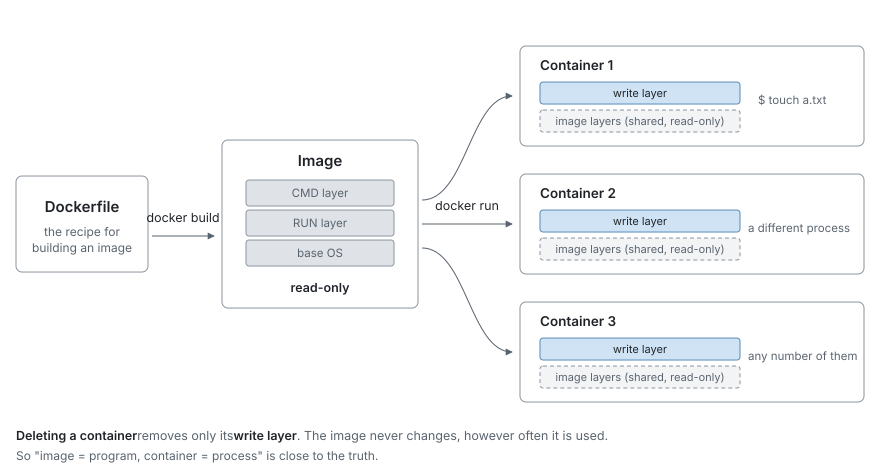

# Docker primer


In the previous chapter Docker started working. This chapter covers the ideas behind Docker itself.
If you are used to Docker, you may skip it and move on to [Setting up a working environment](03-environment.md).

**This project does not appear here.** Every command that appears is a few-line example
using public images, and as long as Docker is installed you can run them as they are on your machine.
The vocabulary covered here — container, image, layer, volume, Compose — is
used without explanation from the next chapter onward.

## What is a container

You often see the explanation "a lightweight virtual machine", but that is not accurate.
Let's actually run one and see what is different.

```bash
docker run --rm ubuntu:24.04 ps -ef
```

Since this is the first command, here is what each part refers to.

| Part | Meaning |
|------|------|
| `docker run` | Create a container from an image and run it |
| `--rm` | **When it exits, delete that container automatically** |
| `ubuntu:24.04` | The image to use |
| `ps -ef` | The command to run inside the container |

Without `--rm`, exited containers keep piling up in a stopped state
and accumulate in `docker ps -a`. Add it when you are experimenting with throwaway containers.

The output looks like this.

```
UID          PID    PPID  C STIME TTY          TIME CMD
root           1       0 20 15:18 ?        00:00:00 ps -ef
```

There is only one process. PID 1 is the `ps -ef` we just asked to run, itself.

On a virtual machine, the kernel boots, init comes up, and daemons line up.
None of that is here. **Only the one command we specified is running.**

So what is a container, then? Checking the following two things makes the outline clear.

### What is shared — the kernel

On a machine whose host is Ubuntu, let's run an **Alpine Linux** container.
Alpine is a different distribution from Ubuntu.

```bash
docker run --rm alpine:3.20 sh -c '. /etc/os-release; echo $PRETTY_NAME'
docker run --rm alpine:3.20 uname -r
```

```
Alpine Linux v3.20
7.0.0-30-generic
```

Let's ask the same thing on the host side.

```bash
. /etc/os-release; echo $PRETTY_NAME
uname -r
```

```
Ubuntu 24.04.4 LTS
7.0.0-30-generic
```

**The distributions differ, yet the kernel is the same.**

A container does not have its own kernel. It uses the host's kernel as it is,
and merely drapes another distribution's set of files on top of it.
`/etc/os-release` answering Alpine is nothing more than Alpine's files being visible.

Changing the image does not change this answer.

```bash
for img in ubuntu:24.04 alpine:3.20 debian:12-slim ubuntu:20.04; do
  docker run --rm $img uname -r
done
```

```
7.0.0-30-generic
7.0.0-30-generic
7.0.0-30-generic
7.0.0-30-generic
```

All four are the host's kernel. **Whichever image you choose, it does not change.**
The last one, `ubuntu:20.04`, is a distribution from 2020, but
it still reports the host's newer kernel.
**What the image decides is only the set of files, not the kernel.**

Put the other way around, anything that depends strongly on the kernel cannot be solved with an image.
Bring in the old `ubuntu:20.04`, and the kernel that is running is still the new one.

> [!NOTE]
> **On macOS / Windows**
>
> Docker Desktop runs one Linux virtual machine and runs containers inside it.
> What is shared is **that virtual machine's kernel**.
>
> ```
> macOS's own kernel       : 25.6.0
> uname -r in the container: 6.12.76-linuxkit
> ```
>
> The story "it shares the host's kernel" does not change, but
> "host" here refers not to macOS but to that virtual machine.

This is where the difference from a virtual machine lies. A virtual machine boots its own kernel,
so booting takes time and it reserves memory as well. A container has none of those steps.

### What is restricted — what is visible

Start one `sleep 300` process and **look up its PID (process number)
in two places: inside the container and on the host side.** The thing being looked up is the same single process.


```bash
docker run -d --name demo ubuntu:24.04 sleep 300

# Both are typed in the host's terminal
docker exec demo ps -ef                    # the PID inside the container
docker inspect -f '{{.State.Pid}}' demo    # the PID on the host side
```


The first, `docker exec`, is typed on the host but
executed inside the container.

What the second one, `.State.Pid`, returns is **the host-side PID of the one process the container started**.
The only thing running in this container is `sleep 300`, so that is what comes back.

Two new options appear here.

| Part | Meaning |
|------|------|
| `-d` | Run it in the background and return to the prompt immediately |
| `--name demo` | Give the container the name `demo` |

`sleep 300` was chosen because we want it **to keep running without exiting**.
With a command like `ps -ef` that finishes immediately, it would be gone before we could look up the PID.

The result is this.

```
PID inside the container: 1
PID on the host side    : 37785
```

Both are the PID of `sleep 300`. The host-side value changes on every run.
What matters is that **one process has two PIDs attached to it, depending on your vantage point**.

A container gets a separate space of PIDs. Within it,
it counts itself from 1 again, and from the host it looks like an ordinary process.

What is easy to misunderstand here is that **it is not that the host's processes appear with changed PIDs**.
Only that container's processes enter the new space.
Even if hundreds of processes are running on the host side, not one of them is visible from the container.

Look it up with `ps` on the host side, and it is listed as usual.

```bash
ps -o pid,cmd -p 37785
```

```
    PID CMD
  37785 sleep 300
```

Once you have checked, clean up with `docker rm -f demo`.

### To summarize

A container is **just a process running on top of the host's kernel**.
Except that Docker has swapped out what that process can see.

Let's line up the same items on the host side and inside the container.
These are the results of running an Alpine container on an Ubuntu host and asking both the same things.
The host-side values vary by environment, so those are shown by description.

| What was asked | Host side | Inside the container | |
|-----------|---------|------------|---|
| `uname -r` | `7.0.0-30-generic` | `7.0.0-30-generic` | **The same** (even if you change the image) |
| Distribution | Ubuntu 24.04.4 | Alpine Linux v3.20 | Different |
| Number of visible processes | 218 (including the container's) | 2 | Different |
| What PID 1 is | `systemd` | `sleep 300` | Different |
| `hostname` | The name you gave it yourself | `e0a4ec4f7347` | Different |
| IP address | The LAN address | `172.17.0.2` | Different |
| `whoami` | The user you logged in as | `root` | Different |
| Contents of `/home` | The login user's directory | Empty | Different |
| The host's files | Visible | **Not visible** | Different |

**Only the kernel is the same**; everything else appears separately.

For the process row, note that **the PIDs are not being renumbered**.
It is not that the host's 218 are also visible from the container with only different PIDs —
**from the container, not one of the host's processes is visible**.
What is visible is only its own 2.

```
$ docker exec demo ps -ef
PID   USER     TIME  COMMAND
    1 root      0:00 sleep 300
    8 root      0:00 ps -ef
```

The second is the `ps` we just ran, itself (the PID changes on every run).
In other words, **the container is effectively running only one process**.

### Only one side becomes invisible

Note, however, that this separation is **one-way**.
The host is not visible from the container, but **the container is visible from the host**.

You can see it by comparing the host's process count before and after starting a container.

```bash
ps -e | wc -l      # before starting
docker run -d --name demo alpine:3.20 sleep 300
ps -e | wc -l      # after starting
```

```
210
218
```

It has gone up (the actual numbers depend on the state of the machine).
The figure 218 in the table was **a count that included the container's processes**.
In fact, searching with the host's `ps` turns it up.

```bash
ps -ef | grep "sleep 300"
```

```
root  42167  42144  16 17:11 ?  00:00:00 sleep 300
```

The process that was PID 1 inside the container is listed as 42167 on the host.
It gets no special treatment; it is in the same listing as every other process.

| | Are the host's processes visible? | Are the container's processes visible? |
|---|---|---|
| From the host | Visible | **Visible** |
| From the container | **Not visible** | Visible (only its own) |

The container is not hidden; it **simply has no idea that it is being watched from the host**.
From the host side, you can `kill` it, and you can look at its state with `ps`.

The filesystem is the same. **Even where the names look alike, a different tree is visible.**

```
$ ls /                      # host
bin  boot  cdrom  dev  etc  home  lib  lib64  lost+found  media  mnt  opt
proc  root  run  sbin  snap  srv  swap.img  sys  tmp  usr  var

$ docker exec demo ls /     # container
bin  dev  etc  home  lib  media  mnt  opt  proc  root  run  sbin  srv
sys  tmp  usr  var
```

Names like `bin` and `etc` exist on both sides, but the contents belong to
each respective distribution. `boot` and `snap`, which exist only on the host side,
do not exist from the container.

As for `/home`, the host has the login user's directory, yet
in the container it is **empty**. Specify a file on the host, and it is not found.

```
$ docker exec demo ls /home/<username>/somefile.txt
ls: /home/<username>/somefile.txt: No such file or directory
```

**Not one of the host's files is visible from the container.** If you want to show some,
you have to connect them explicitly with the bind mount described later.

The other direction, same as with processes, **is visible**. We use the 42167 from before.

```bash
sudo ls /proc/42167/root/
```

```
bin  dev  etc  home  lib  media  mnt  opt  proc  root  run  sbin  srv  sys  tmp  usr  var
```

`/proc/<PID>/root` points to the `/` that the process sees.
The container's `/` comes out just as it is. The only difference is that `sudo` is required.

None of the values inside the container are lies.
Process number `1` really does exist, and `172.17.0.2` really can communicate.
**The visible world itself has been swapped out**, and
it is not that the numbers are being faked.

As long as the kernel is the same, the container has not booted an OS of its own.
What has been started is only the one process it was told to run.

The mechanism that swaps out what is visible is called **namespace**, and the one that limits
the amount of CPU and memory available is called **cgroup**. Both are features of the Linux kernel,
not something Docker created. **Docker is a tool that packages them so they are easy to handle.**

The fact that startup finishes in an instant is explained by this too.
There is no OS startup to wait for in the first place.

### Users are one notch trickier

In the table above, the `whoami` row was "different". Inside the container it is `root`,
on the host it is your own login name.

And yet **when you look at the same process from both the container and the host, the story changes**.
The PID was `1` inside the container and a different value on the host side.
What about the user?

```bash
docker run -d --name demo alpine:3.20 sleep 300
docker exec demo id
```

```
uid=0(root) gid=0(root) groups=0(root),...
```

Inside the container it is UID 0, that is, root.
So what is this process from the host's point of view?


```bash
ps -o uid=,pid=,cmd= -p $(docker inspect -f '{{.State.Pid}}' demo)
```


```
    0   39484 sleep 300
```

**It is UID 0 both inside the container and on the host side.**
The PID came out as different values in the container and on the host, yet the UID stays the same value.

In other words, root inside the container is treated as the same person as root on the host.
It does not get remapped to a different value.

Change it with `--user`, and that goes through as it is too.


```bash
docker run -d --name demo2 --user 1000 alpine:3.20 sleep 300
docker exec demo2 id         # uid=1000
ps -o uid= -p $(docker inspect -f '{{.State.Pid}}' demo2)
```


```
 1000
```

In this case too it is 1000 both in the container and on the host.

| For the same process | Seen from inside the container | Seen from the host |
|---|---|---|
| PID | `1` | `39484` ← becomes a different value |
| UID (default) | `0` | `0` ← **the same value** |
| UID (`--user 1000`) | `1000` | `1000` ← **the same value** |

**The PID becomes a different value in the container and on the host, yet the UID stays the same value.**
This leads directly into the next warning.

> [!WARNING]
> **This is what bites you with bind mounts**
>
> A container runs as root by default. Write to a host directory that way,
> and **files owned by UID 0 are left on the host side too**.
>
> The actual symptom is covered later, in "[Two ways to keep data](#two-ways-to-keep-data)".
> To avoid it, either specify your own UID with `--user`,
> or use a volume so that nothing writes directly into a host directory.

## The relationship between images and containers

The `ubuntu:24.04` part is the **image**. It is a read-only template
packed with the contents of a filesystem, and containers are made from it.

Drawn as a figure, the relationship looks like this.



From one image you can make any number of containers.

```bash
docker run -d --name demo1 ubuntu:24.04 sleep 60
docker run -d --name demo2 ubuntu:24.04 sleep 60
docker ps
```

```
demo2   ubuntu:24.04   Up Less than a second
demo1   ubuntu:24.04   Up Less than a second
```

Clean up afterwards with `docker rm -f demo1 demo2`.

The two containers run separately while sharing the same image as their base.
A file created in one is never visible from the other.

### Where do images come from

`ubuntu:24.04` is not something we prepared in advance. If it is not on your machine,
it is downloaded automatically from a public store called **Docker Hub**.
You can also download it explicitly.

```bash
docker pull debian:12-slim
```

```
774043ccc8cc: Pull complete
Digest: sha256:3783cc01769c7b2b1b83a5c5ad96c815348e28ed7da68e2e3687004faa906251
Status: Downloaded newer image for debian:12-slim
docker.io/library/debian:12-slim
```

The last line is the name written out without abbreviation.

```
docker.io  /  library  /  debian  :  12-slim
─────────     ───────     ──────     ───────
  store       author        name       tag
```

Normally you can write it short. `docker.io` is the default so it can be omitted,
and `library` (things prepared by Docker officially) can be omitted too.
For things that are not official, the author's name remains.

| Short form | The actual name |
|-----------|-----------|
| `ubuntu:24.04` | `docker.io/library/ubuntu:24.04` |
| `alpine:3.20` | `docker.io/library/alpine:3.20` |
| `ollama/ollama` | `docker.io/ollama/ollama:latest` |

The tag points to a version. Omit it and it becomes `latest`, but
**the contents change before you notice**, so being explicit, as in `ubuntu:24.04`, is the sure way.

### What to choose as a base

There are several images for OSes alone, and their sizes differ.


```bash
docker images --format "{{.Repository}}:{{.Tag}}\t{{.Size}}"
```


The ones you have already downloaded are listed. Picking out the four touched on in this chapter, it looks like this.

```
alpine:3.20	11.8MB
nginx:alpine	93MB
debian:12-slim	114MB
ubuntu:24.04	117MB
```

`alpine` is extremely small. That is because it is built with a minimal configuration,
and it is the reason we have used it for the short examples in this chapter.
On the other hand, there are differences too: `apt` is not available, and some software does not run.

It is not necessarily an OS. **If what you want to do is already decided, there is an image dedicated to it.**

| Image | Contents |
|---------|------|
| `nginx` | A web server is in it, and it works as soon as you start it |
| `postgres` | A database |
| `python` / `node` | A language runtime |
| `ollama/ollama` | An LLM runtime (used in the next chapter) |

Rather than assembling from a base yourself, it is faster to put something close in `FROM` and add only what you need.
This project's `Dockerfile`, which we read in the next chapter, also uses `ubuntu:24.04` as its base.

## Changes to a container do not stick

Files created inside a container disappear along with that container.

```bash
docker run --rm ubuntu:24.04 bash -c "touch /tmp/a.txt; ls /tmp/"
```

```
a.txt
```

Let's check once more, in a different container.

```bash
docker run --rm ubuntu:24.04 ls /tmp/
```

Nothing is output. The `a.txt` created in the previous container does not exist.

The image is read-only, and a container runs with a thin writable layer stacked on top of it.
Delete the container, and that layer goes with it. **Anything you want to keep** has to be put somewhere else.
How to do that is covered in the second half.


## An image is made of layers

An image is not a monolith. It is a collection of layers with changes stacked up.


```bash
docker history ubuntu:24.04 --format "{{.Size}}\t{{.CreatedBy}}"
```


```
0B	/bin/sh -c #(nop)  CMD ["/bin/bash"]
85.1MB	/bin/sh -c #(nop) ADD file:6c214fc3c3c22122c…
0B	/bin/sh -c #(nop)  LABEL org.opencontainers.…
0B	/bin/sh -c #(nop)  ARG LAUNCHPAD_BUILD_ARCH
0B	/bin/sh -c #(nop)  ARG RELEASE
```

There are 5 layers. In substance, though, there is just one layer with an 85.1MB set of files,
and the rest are settings that carry no size.

This conflicts with `docker images` reporting 117MB, but both are correct.
**`docker history` shows the size at the point the layer was created, and `docker images` shows
the size when expanded and placed on disk.**

Layers have two advantages.

- **They are shared** — another image that uses the same layer reuses it.
  Even if 10 images use the same Ubuntu as their base, that 85.1MB is only needed once
- **They are cached** — layers that have not changed are not rebuilt

The second one leads directly to build times in the next chapter.

## Building an image with a Dockerfile

Your own image is built from an instruction sheet called a `Dockerfile`. Three lines are enough.

Create a directory to work in.

```bash
mkdir primer && cd primer
```

Save the following inside it, under the name `Dockerfile`.

```dockerfile
FROM ubuntu:24.04
RUN apt-get update && apt-get install -y --no-install-recommends cowsay \
    && rm -rf /var/lib/apt/lists/*
CMD ["/usr/games/cowsay", "Hello"]
```

Build it in the same directory and run it.

```bash
docker build -t primer-demo .
docker run --rm primer-demo
```

`-t primer-demo` is the name given to the image that comes out.
The `.` at the end is the place where you put the `Dockerfile`, which here means the current directory.
If you type it from somewhere else, pass that directory's path instead of `.`.

```
 _______
< Hello >
 -------
        \   ^__^
         \  (oo)\_______
            (__)\       )\/\
                ||----w |
                ||     ||
```

The roles of the three instructions are as follows.

| Instruction | When it runs | What it does |
|------|-----------|-----------|
| `FROM` | — | Specifies the image to use as a base |
| `RUN` | **During the build** | Runs a command and bakes the result into the image |
| `CMD` | **Every time it starts** | The default command that runs when a container is created |

The difference between `RUN` and `CMD` is the key point. `apt-get install` only needs doing once,
so it is `RUN` (left in the image); `cowsay` is something we want to run every time, so it becomes `CMD`.

In an actual `Dockerfile`, the following three are also often used.

| Instruction | What it does |
|------|-----------|
| `ENV` | Sets an environment variable. It applies both to the instructions that follow and at container runtime |
| `COPY` | Copies files from the host into the image. With `--from` it can also take them from another image |
| `WORKDIR` | Decides the base directory from then on (creates it if it does not exist) |

Looking at the layers that were created, you can see them stacked in the order written.


```bash
docker history primer-demo --format "{{.Size}}\t{{.CreatedBy}}"
```


```
0B	CMD ["/usr/games/cowsay" "Hello"]              ← the CMD we wrote ourselves
54.4MB	RUN /bin/sh -c apt-get update && apt-get ins…  ← the RUN we wrote ourselves
0B	/bin/sh -c #(nop)  CMD ["/bin/bash"]           ┐
85.1MB	/bin/sh -c #(nop) ADD file:6c214fc3c3c22122c…  │
0B	/bin/sh -c #(nop)  LABEL org.opencontainers.…  ├ the layers of the
0B	/bin/sh -c #(nop)  ARG LAUNCHPAD_BUILD_ARCH    │ ubuntu:24.04 given in FROM
0B	/bin/sh -c #(nop)  ARG RELEASE                 ┘
```

(The annotations on the right were added for the explanation and are not part of the output)

Only three lines are written in the `Dockerfile`, yet there are 7 layers.
**The bottom 5 layers belong to the `ubuntu:24.04` specified in `FROM`.**
Comparing makes it clear.


```bash
docker history ubuntu:24.04 --format "{{.Size}}\t{{.CreatedBy}}"
```


```
0B	/bin/sh -c #(nop)  CMD ["/bin/bash"]
85.1MB	/bin/sh -c #(nop) ADD file:6c214fc3c3c22122c…
0B	/bin/sh -c #(nop)  LABEL org.opencontainers.…
0B	/bin/sh -c #(nop)  ARG LAUNCHPAD_BUILD_ARCH
0B	/bin/sh -c #(nop)  ARG RELEASE
```

Exactly the same thing is underneath.

`FROM` does **not** create a layer. It uses the layers of an image that already exists as the base, as they are.
That is why no line saying `FROM` appears in `docker history`, and
instead the layers the base image had are listed.

This base **is shared**. However many other images you build with the same
`ubuntu:24.04` in `FROM`, this 85.1MB never increases.

Incidentally, the third from the bottom, `CMD ["/bin/bash"]`, is what the Ubuntu image
had, and our own `CMD` at the very top overrides it.
Both remain as layers, but the one actually used is the one written last.

## Two ways to keep data

To keep data even after deleting a container, connect a place on the host side to the container.
There are two ways, and **they are for different purposes**.

### Volume — a storage place Docker manages

```bash
docker volume create primer-vol
docker run --rm -v primer-vol:/data ubuntu:24.04 bash -c "echo saved > /data/note.txt"
```

`-v` is the option that specifies where in the container the storage place is shown.
`-v primer-vol:/data` means "show the volume called `primer-vol`
to the container as `/data`".

The container is gone, because of `--rm`. Let's read it from another container.

```bash
docker run --rm -v primer-vol:/data ubuntu:24.04 cat /data/note.txt
```

```
saved
```

It is still there. The substance of a volume lies in an area Docker manages, and
you use it without being conscious of where it is on the host. It suits things,
**like the contents of a database, that you do not edit directly**.

### Bind mount — showing a host directory as it is

```bash
mkdir -p /tmp/demo
echo "from the host" > /tmp/demo/host.txt
docker run --rm -v /tmp/demo:/mnt ubuntu:24.04 cat /mnt/host.txt
```

```
from the host
```

A file edited on the host is visible from the container as it is. The reverse direction is the same:
append to it inside the container, and the file on the host side changes.
It suits **source code that you want to edit while running**.

| | Where the substance is | What it suits |
|---|-----------|--------------|
| **Volume** | Docker's managed area | DBs, caches, models |
| **Bind mount** | The specified directory on the host | Source code, config files |

These two, plus **inside the image**, make three kinds, and they are all of the sources
of the files visible from a container. Where you put something changes when it disappears.

| Source | When it disappears |
|---------|------------|
| Inside the image | It does not disappear. However, **anything you rewrote disappears along with the container** (things installed with `RUN` are here) |
| Volume | It stays until you delete it explicitly |
| Bind mount | It is a file on the host side, so Docker does not delete it |

> [!WARNING]
> **On Linux, watch out for ownership**
>
> Since [UIDs are not remapped](#users-are-one-notch-trickier),
> when a container that runs as root by default writes to a bind mount,
> files owned by UID 0 are left on the host side too.
>
> ```bash
> docker run --rm -v /tmp/demo:/mnt ubuntu:24.04 touch /mnt/made-in-container.txt
> ls -l /tmp/demo/made-in-container.txt
> ```
>
> ```
> root root /tmp/demo/made-in-container.txt
> ```
>
> Docker Desktop on macOS converts ownership so it does not surface there; it is a Linux-specific pitfall.
>
> Run it with `--user "$(id -u):$(id -g)"` added, and files are created owned by you.

## Compose — bundling multiple containers

Up to here we have typed `docker run` one at a time. But a real system
runs with multiple containers working together — a web server and a database, say.

`docker compose` is a mechanism for **listing the containers you use in a `docker-compose.yml`
and operating on them together**.

Let's check by doing. Create an empty directory and place a
`docker-compose.yml` with the following contents.

```yaml
services:
  web:
    image: nginx:alpine

  client:
    image: alpine:3.20
    command: sleep infinity
```

What is listed under `services:` is **the list of containers** this file defines.
Here there are two, `web` and `client`. You name them yourself.

| Service name | Image used | What is run |
|-----------|------------|-----------|
| `web` | `nginx:alpine` | The image's default nginx |
| `client` | `alpine:3.20` | `sleep infinity` (keeps it running) |

Start them.

```bash
docker compose up -d
docker compose ps
```

```
SERVICE   IMAGE          STATUS
client    alpine:3.20    Up 1 second
web       nginx:alpine   Up 1 second
```

With one `up -d`, both of the things written under `services:` started.
This is what "operating on them together" means.


### The service name becomes the hostname as it is

From inside `client`, you can connect using the name `web`.

```bash
docker compose exec client wget -qO- http://web
```

```
<title>Welcome to nginx!</title>
```

The IP address is written nowhere. The name is being resolved.

```bash
docker compose exec client getent hosts web
```

```
172.20.0.3        web  web
```

To do the same thing with `docker run`, you would have to make the container look up the IP,
or create a network yourself and connect to it. Compose takes that over for you.

### The project name is attached to everything

Compose treats what one `docker-compose.yml` creates as a single bundle.
This bundle is called a **project**, and it has a name.

```bash
docker compose ls
```

```
NAME            STATUS       CONFIG FILES
compose-demo    running(2)   /path/to/compose-demo/docker-compose.yml
```

`NAME` is the project name. **By default, the name of the directory where the
`docker-compose.yml` is placed** is used as it is. In the example above it was run in a
directory called `compose-demo`, so the project name is `compose-demo` too.

This project name gets attached to everything Compose creates.

| What is created | How the name is formed | In the example above |
|------------|------------|-----------|
| Container | `project-name-service-name-number` | `compose-demo-web-1` |
| Network | `project-name_default` | `compose-demo_default` |
| Volume | `project-name_volume-name` | `compose-demo_sample` |

The `1` at the end of the container name shows which instance of the same service it is.
When you run only one, it is always `1`.

The advantage of names being separated is that **even if you run the same `docker-compose.yml`
in a different directory, they do not get mixed up**. If the project names differ,
containers, networks, and volumes are all created as separate things.

You can also specify it independently of the directory name.

```bash
docker compose -p myname up -d
```

```
myname-web-1
```

Cleaning up also takes just one command.

```bash
docker compose down
```

```
Container compose-demo-client-1  Removed
Network compose-demo_default  Removing
Network compose-demo_default  Removed
```

Containers and networks are deleted together. Volumes remain (add `-v` to delete them).

### Settings passed to a service

Under `services:` you can write things other than the image and `command`.
Let's add the commonly used ones and try them.

```yaml
services:
  web:
    image: nginx:alpine
    environment:
      GREETING: ${GREETING:-hello}
    depends_on:
      - client

  client:
    image: alpine:3.20
    command: sleep infinity
    stdin_open: true
    tty: true
```

| Item | What it does |
|------|-----------|
| `environment` | Passes environment variables to the container |
| `${GREETING:-hello}` | Uses the host side's `GREETING`, and **`hello` if it is unset** |
| `depends_on` | Decides the startup order. `client` first, `web` after |
| `stdin_open` / `tty` | Allocates a terminal for interaction. For `docker compose exec ... bash` |

Let's check.

```bash
docker compose up -d
docker compose exec web sh -c 'echo "GREETING=$GREETING"'
```

```
GREETING=hello
```

Place a `.env`, and it is overridden.

```bash
echo 'GREETING=overridden' > .env
docker compose up -d
docker compose exec web sh -c 'echo "GREETING=$GREETING"'
```

```
GREETING=overridden
```

**A `.env` is read simply by being placed in the same directory.** When you want to keep settings secret too,
write only `${...}` in the `docker-compose.yml` and put the values in `.env`.

The startup order is visible too.


```bash
docker compose ps --format '{{.Service}}\t{{.Status}}'
```


```
client	Up 1 second
web	Up Less than a second
```

Following `depends_on`, `client` has started first.

> [!WARNING]
> **`depends_on` only waits until "it started"**
>
> What it waits for is only the container starting; **it does not wait until the service inside is able to respond**.
> Start a database first, and the application may still go to connect before it accepts connections.

### Connecting to the host — `extra_hosts`

Sometimes you want to connect from a container to a service running on the host side.
A name called `host.docker.internal` is available, but **on Linux it cannot be resolved by default**.

```yaml
    extra_hosts:
      - "host.docker.internal:host-gateway"
```

Write this, and `host.docker.internal` points to the host on Linux too.
`host-gateway` is a special Docker value meaning "the host's IP".

### Using an image you built yourself — `build`

`image:` fetches a ready-made image.
To build from your own `Dockerfile`, use `build:`.

```yaml
services:
  app:
    build: .          # use the Dockerfile in this directory
```

`docker compose up -d` builds automatically if the image does not exist.
After rewriting the `Dockerfile`, rebuild with `docker compose build`.

### From startup to shutdown

Lining up what each Compose command does, it looks like this.

```
docker compose build     Build an image from the Dockerfile (stack the layers)
        │
docker compose up -d     Create containers from the image and start them
        │                Connect the volumes and bind mounts
        │                Create a network where services can be looked up by name
        │
docker compose exec      Run an additional process inside a running container
        │
docker compose down      Delete the containers and the network
                         Volumes and the host's files remain
        │
docker compose down -v   Delete the volumes too
                         Whatever was accumulated inside is lost
```

The key point is that `exec` **only runs an additional process inside**.
However many times you run it, the container keeps running, and even when the
command you `exec`'d finishes, the container does not stop.

> [!NOTE]
> **`up -d` does not wait for readiness**
>
> `up -d` instructs the containers to start and returns immediately.
> In the example above too, `wget` right after startup can give you
> `Connection refused`. That is because you go to connect before nginx has begun listening.
> It takes even longer before the service inside responds.

The `docker-compose.yml` covered in the next chapter has the same shape.
There are two services, `app` and `ollama`, and from inside `app` you connect to
`ollama` by that hostname.

## Commands that appeared in this chapter

| Command | Purpose |
|---------|------|
| `docker run --rm <image> <command>` | Run one container and throw it away |
| `docker ps` / `docker ps -a` | List what is running / everything |
| `docker rm -f <name>` | Force-delete a container |
| `docker pull <image>` | Download an image |
| `docker images` | List the images on your machine |
| `docker rmi <image>` | Delete an image |
| `docker history <image>` | Look at the layer structure |
| `docker build -t <name> .` | Build an image from a `Dockerfile` |
| `docker volume create` / `ls` / `rm` | Operate on volumes |
| `docker compose up -d` / `ps` / `down` | Operate on the contents of a configuration file together |

## Next

The vocabulary is in place. In [Setting up a working environment](03-environment.md), we actually start this project.
The `Dockerfile` and `docker-compose.yml` that appear there are
made of the same parts we saw in this chapter.
