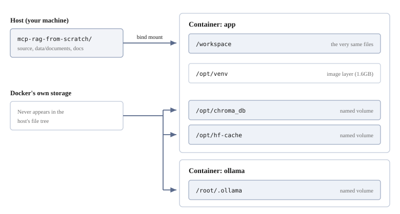

# Setting up a working environment


Let's get the environment for running this project in order, and confirm that it works.

What we read is `docker-compose.yml`.
Make sure you have a grip on **which data is shared with the host and which exists only inside the container**.
Without understanding this, things you thought you deleted remain, and things you thought would remain disappear.

## The whole picture

There are two containers running.

| Container | Role | Where it comes from |
|---------|------|--------------|
| `app` | Runs this project's code | Built from the `Dockerfile` |
| `ollama` | Runs the LLM | Uses a public image as it is |

Within them, storage places divide into three kinds.



| Container | Location | Contents | Visible from the host? | When it disappears |
|---------|------|------|-----------------|------------|
| `app` | `/workspace` | Source, `data/documents`, `docs` | **Visible. The same files** | Does not disappear |
| `app` | `/opt/venv` | Python and the dependency packages (1.6GB) | Not visible | When you delete the image |
| `app` | `/opt/chroma_db` | The substance of ChromaDB (520KB) | Not visible | With `down -v` |
| `app` | `/opt/hf-cache` | The embedding model (471MB) | Not visible | With `down -v` |
| `ollama` | `/root/.ollama` | Ollama's models | Not visible | With `down -v` |

The split is: **the things you edit on the host side, the things that get generated inside the container**.

## Reading `docker-compose.yml`

### The source is shared with the host

```yaml
    volumes:
      - .:/workspace
```

This is the bind mount we saw in chapter 2. The top of the project appears wholesale at `/workspace`.
**It is reflected the moment you save**, so there is no need to rebuild the container every time you fix the code.

### Generated things are placed inside the container

```yaml
    volumes:
      - hf-cache:/opt/hf-cache
      - chroma-db:/opt/chroma_db
```

These are named volumes, and **they do not appear in the host's file tree**.

Inside the container they are visible.

```bash
docker compose exec app ls /opt/chroma_db
```

```
5a7ada9a-78e7-40fc-8366-3a41162e8f19
chroma.sqlite3
```

Look up the same name on the host, and it is not there.

```bash
ls chroma_db
```

```
ls: cannot access 'chroma_db': No such file or directory
```

**The reason they are not placed under `/workspace`** has to do with ownership.
Inside the container we run as root, so writing to `/workspace`
**leaves root-owned files on the host side**.

For the same reason, the caches Python generates are turned off.

```yaml
    environment:
      PYTHONDONTWRITEBYTECODE: "1"
      PYTEST_ADDOPTS: "-p no:cacheprovider"
```

Without this, `__pycache__` and `.pytest_cache` are left on the host owned by root.

### The virtual environment is inside the container too

```dockerfile
ENV UV_PROJECT_ENVIRONMENT=/opt/venv
```

By default `.venv` is created directly under the project, but that is a problem.
`/workspace` is shared with the host, so **the `.venv` created on the host side and
the container's `.venv` fight over the same place**. The binaries inside them are different things,
so if they get mixed up, nothing works.

It is moved out of the way to `/opt/venv`, so even if you have run `uv sync` on the host side there is no collision.

```bash
docker compose exec app du -sh /opt/venv
```

```
1.6G	/opt/venv
```

It is baked into **a layer of the image**, not a volume. It does not disappear with `down -v`;
it disappears when you delete the image.

### The two services

```yaml
services:
  app:
    build: .
    depends_on:
      - ollama
    environment:
      OLLAMA_HOST: ${OLLAMA_HOST:-http://ollama:11434}

  ollama:
    image: ollama/ollama:latest
```

From `app` to `ollama`, **the service name becomes the hostname as it is**.
There is no need to look up and write an IP.

### Checking that they are connected

Call `ollama` from inside `app`.

```bash
docker compose exec app curl -s http://ollama:11434/api/version
```

```json
{"version":"0.40.2"}
```

**If this comes back, the two containers are connected.** That is all we want to confirm here.
Downloading the model and actually running the LLM is done in [Setting up Ollama](08-ollama-setup.md).

If you are running Ollama on the host side and want to use that one, override it in `.env`.

```bash
OLLAMA_HOST=http://host.docker.internal:11434
```

## Starting up and stopping

Compose operations themselves were covered in [Docker primer](02-docker-basics.md#from-startup-to-shutdown).
Here we list the ones you actually type for this project.

```bash
docker compose up -d
```

```
 Container mcp-rag-from-scratch-ollama-1  Started
 Container mcp-rag-from-scratch-app-1     Started
```

The work is done inside the container.

```bash
docker compose exec app bash
```

```
root@3a77c9ea:/workspace#
```

**The working directory is `/workspace`**, and the host's project is visible there as it is.
Since `uv sync` has installed the project as editable, **`PYTHONPATH` is not needed**.

```bash
uv run python steps/01_chromadb.py
uv run python -m server.indexer
uv run python tools/query_chromadb.py
uv run pytest
```

Leave with `exit`, and stop things with `docker compose down`.

> [!NOTE]
> When you change the `Dockerfile` or `pyproject.toml`, rebuild the image.
>
> ```bash
> docker compose build app
> docker compose up -d
> ```

### `down -v` deletes the embedding model too

The volumes go with it, so you end up downloading the 471MB embedding model again next time.
**Normally `down` is enough.**

## Confirming that it works

Finally, let's run everything together.

```bash
docker compose exec app uv run pytest
```

```
17 passed, 1 warning in 37.98s
```

**That is the end of the environment.** Two containers start, they are connected to each other,
the source is shared with the host, and generated things stay in volumes.

## When you run into trouble

### It says `no configuration file provided`

You are not running it in the directory where `docker-compose.yml` is.

```bash
cd /path/to/mcp-rag-from-scratch
ls docker-compose.yml
```

### It says `steps/01_chromadb.py` cannot be found

The working directory inside the container is `/workspace`.
Pass a host-side path as it is, and it will not be found.

```bash
docker compose exec app pwd
docker compose exec app ls steps/
```

### The embedding model is downloaded every time

You are deleting the volumes with `down -v`. If `hf-cache` remains, it is reused.

```bash
docker volume ls --filter name=hf-cache
```

### You get an error about `.venv`

The container is picking up the host side's `.venv`.
Check whether `UV_PROJECT_ENVIRONMENT=/opt/venv` is in effect.

```bash
docker compose exec app sh -c 'echo $UV_PROJECT_ENVIRONMENT'
```

### Files inside the container differ from the host

Under `/workspace` they are the same substance. If they look different,
you are looking under `/opt` (a volume).

```bash
docker compose exec app ls /workspace
docker compose exec app ls /opt/chroma_db
```

### Downloading the model fails at name resolution

The container cannot get outside. First, narrow it down.

```bash
docker compose exec app getent hosts huggingface.co
docker compose exec app ip addr show eth0
```

If no IP is attached, it is a network problem, not DNS.

The reason `ollama`'s port is not published in `docker-compose.yml` is
to avoid a collision on 11434 when Ollama is running on the host side.

### The build fails partway through

Throw away the cache and retry.

```bash
docker compose build --no-cache app
```

## Next

From here on it is **a story about the contents**. What is happening on top of this environment —
we will check it by running the parts one by one.

The first is [Running ChromaDB](04-chromadb.md).
We start from **putting documents in and taking out the ones close to a question**.
