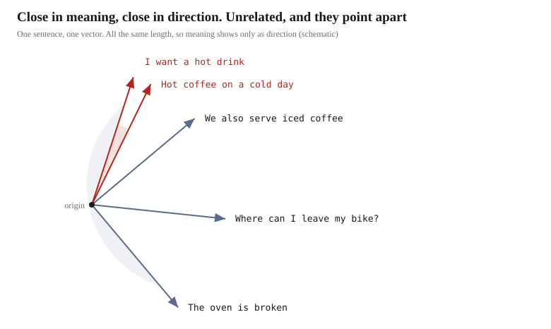

# Running ChromaDB


## What is ChromaDB

It is a **vector database**. Hand it a string, and it converts it into "a sequence of numbers that expresses meaning",
that is, a **vector**, and stores it; hand it a question, and it returns things **in order of closeness**.

With an ordinary database you could look things up with `LIKE '%warm%'`. But with that,
you cannot retrieve `Espresso drinks arrive steaming` from the question "I want a warm drink".
**Because the characters do not match.**



Turn sentences into vectors, and closeness of meaning becomes **closeness of direction**.
ChromaDB returns this difference in direction as a **distance**, and lines them up from smallest to largest.

## Reading the code

Of `steps/01_chromadb.py`, **only four lines are involved in the flow of searching**.
(Besides these, it uses `get()` to peek at the stored vectors and `count()` to count the items)

```python
client = chromadb.Client()                    # open the database
collection = client.create_collection(...)    # create a collection
collection.add(...)                           # register the documents
collection.query(...)                         # search with a question
```

Let's look at them in order.

### Preparing the embedding function

Build the part that turns strings into vectors.

```python
from chromadb.utils.embedding_functions import SentenceTransformerEmbeddingFunction

embedding_function = SentenceTransformerEmbeddingFunction(
    model_name="intfloat/multilingual-e5-small"
)
```

**It takes a list of strings and returns a list of 384-dimensional vectors.** That is all this part does.

### Creating a collection

```python
client = chromadb.Client()          # In memory. It disappears when the process ends
collection = client.create_collection(
    name="cafe",
    embedding_function=embedding_function,
)
```

A **collection** is where documents are kept; it corresponds to a table in an RDB.
If you want to keep it on disk, use `chromadb.PersistentClient(path=...)`.

The embedding function is tied in here. From then on, both `add()` and `query()` call it internally,
so there is no point at which the calling side handles vectors directly.

### Registering documents — `add()`

Let's first build what we pass in. Read the `.txt` files in `data/documents` and make a list.

```python
files = []
for txt_file in sorted(DOCUMENTS_PATH.glob("*.txt")):
    content = txt_file.read_text(encoding="utf-8")
    files.append({"filename": txt_file.name, "content": content})
```

`txt_file.name` is the file name, and `content` is its contents.
So `files` becomes a list with **one dictionary per file**, which for 7 files means 7 items.
The first item looks like this.

```python
{"filename": "allergens.txt", "content": "The Wandering Kettle - Ingredients..."}
```

We rearrange this into two lists and pass them in.

```python
collection.add(
    ids=[f["filename"] for f in files],
    documents=[DOCUMENT_PREFIX + f["content"] for f in files],
)
```

That is, `ids` is **a list of file names** and `documents` is **a list of file contents**.

```python
ids       = ["allergens.txt", "faq.txt", "hours_access.txt", ...]
documents = ["passage: The Wandering Kettle - Ingredients...",
             "passage: The Wandering Kettle - Questions...", ...]
```

Both have 7 items, in the same order. `ids[0]` and `documents[0]` point to the same file.

`ids` only has to be unique. Here we use the file names as they are.
The strings passed to `documents` **become vectors as they are**.

> [!NOTE]
> **What `DOCUMENT_PREFIX` really is**
>
> ```python
> DOCUMENT_PREFIX = "passage: "
> QUERY_PREFIX = "query: "
> ```
>
> E5-family models are trained with separate markers attached to stored documents and to search queries.
> They still work if you forget to attach them, but accuracy drops. It is a convention fixed per model.

### Searching with a question — `query()`

```python
results = collection.query(
    query_texts=["query: What time do you close on Friday?"],
    n_results=3,
)
```

The question becomes a vector through the same embedding function. Since `n_results=3`, 3 items come back.

```python
>>> results["ids"]
[['hours_access.txt', 'staff_handbook.txt', 'menu_food.txt']]

>>> results["distances"]
[[0.1989266276359558, 0.20826709270477295, 0.21306967735290527]]
```

What is lined up in `ids` are the **file names** we passed in at `add()` time.
`distances` are the respective **distances**, and **the smaller, the closer to the question**.
The order is from smallest distance, so the first one, `hours_access.txt`, is in 1st place,
and the third item, `menu_food.txt`, is in 3rd place.

**And both lists are doubly nested.** The 3 items on the inside are the search results, and
the outside is per question. `query_texts` is a list, so throw in 2 questions and the outside has 2 items.

```python
>>> r = collection.query(query_texts=["query: What time do you close on Friday?",
...                                    "query: Do you have oat milk?"], n_results=2)
>>> r["ids"]
[['hours_access.txt', 'staff_handbook.txt'], ['allergens.txt', 'menu_drinks.txt']]
```

The outside is a list even with one question, and the inside is a list even with `n_results=1`.
**The shape does not change even with a single element**, so you cannot leave out the subscripts.

In other words, **you select the question with the outer subscript and the rank with the inner subscript**.
With `n_results=3` returning 3 items, getting the 1st place means following two levels.

```python
results["ids"][0]             # the results for the first question. 3 items in it
                              # -> ['hours_access.txt', 'staff_handbook.txt', 'menu_food.txt']
results["ids"][0][0]          # the 1st place among them -> 'hours_access.txt'
results["documents"][0][0]    # the body of the 1st place
results["distances"][0][0]    # the distance of the 1st place -> 0.1989266276359558
```

---

## Running it and checking

Running is done inside a Docker container. Start the container **at the top of the project**.

```bash
docker compose up -d
```

Once it is up, run the script inside the container.

```bash
docker compose exec app uv run python steps/01_chromadb.py
```

If you are going to try it many times, it is faster to go into the container.
Inside is an ordinary Ubuntu, and the working directory is `/workspace`.

```bash
docker compose exec app bash
uv run python steps/01_chromadb.py
```

The first run takes a while, because the embedding model (about 470MB) gets downloaded.
From the second run on, it is read from the cache.

**There is no procedure for creating the database in advance.** ChromaDB is created in memory,
and it disappears when the run finishes. You can redo it as many times as you like.

### Trying it interactively

To try it while changing the question, start Python in interactive mode.

```bash
docker compose exec app bash
uv run python
```

The following 7 lines put you in the same state as the script.

```python
import chromadb
from pathlib import Path
from chromadb.utils.embedding_functions import SentenceTransformerEmbeddingFunction

ef = SentenceTransformerEmbeddingFunction(model_name="intfloat/multilingual-e5-small")
collection = chromadb.Client().create_collection("demo", embedding_function=ef)
for p in sorted(Path("data/documents").glob("*.txt")):
    collection.add(ids=[p.name], documents=["passage: " + p.read_text()])
```

After that you can call `query()` directly. The `>>>` output we saw above can be reproduced here.

```python
>>> r = collection.query(query_texts=["query: Do you have oat milk?"], n_results=2)
>>> r["ids"]
[['allergens.txt', 'menu_drinks.txt']]
```

Rewrite what comes after `query:`, and you can try any question.

When you are done, stop the container.

```bash
docker compose down
```

**The embedding model's cache stays in a volume**, so it is not re-downloaded next time.
If you want to delete it, use `docker compose down -v`.

> [!NOTE]
> Installing Docker is in [What you need and installing Docker](01-setup.md),
> and building and day-to-day operations are in [Setting up a working environment](03-environment.md).

The material is the 7 files of the fictional cafe **The Wandering Kettle**, placed in `data/documents/`.
The following is an excerpt of the output.

### It can be retrieved even when no word matches

```
  Question: I want something warm to drink because it is freezing outside
    distance 0.165  menu_drinks.txt
    "warm" appears in that file: False
    "freezing" appears in that file: False
    "outside" appears in that file: False
```

**Keyword search would never return this.** What is written there is a different expression.

```
Espresso drinks arrive steaming in a heavy ceramic cup that keeps
its temperature for a good twenty minutes.
```

`steaming` sits in a position close to "warm" within the space.

### How to read the distance

The distance is a **cosine distance**, and the better the directions align, the closer it gets to 0.
The absolute value carries no meaning; look only at **the ranking within the same search**.

## What we have learned so far

- What you hand to ChromaDB is strings. Vectorization happens on the library's side
- Regardless of length, one document becomes one 384-dimensional vector
- Vector search is not looking at word matches. That is why paraphrases retrieve things too
- The distance is a cosine distance. Read it as a ranking, not as an absolute value

In the next chapter, we **build this database on disk ahead of time**
and prepare a `search()` that can be called later.
