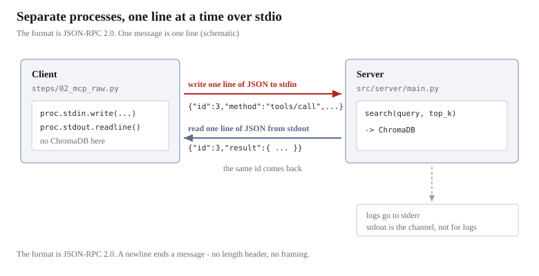
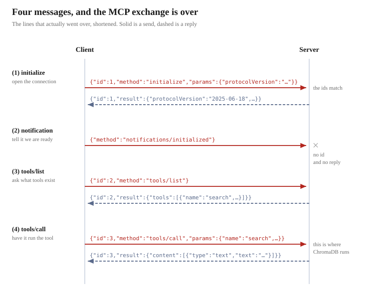

# Speaking MCP in raw JSON-RPC


This is the main subject from here on. The `search()` we prepared in the previous chapters —
we **call it from another process**. The agreement for doing that is MCP.

## What is exchanged is JSON

In this chapter we read and write JSON. Only two symbols are needed.

| Symbol | Meaning |
|------|------|
| `{ }` | **A pair of a name and a value**. The name is always a string, written as `"name": value` |
| `[ ]` | **A sequence**. Values are put in, separated by commas |

Besides strings, numbers, and booleans, values can contain `{ }` and `[ ]` as they are.
This nesting is all there is to JSON.

```json
{
  "name": "search",
  "top_k": 3,
  "results": ["hours_access.txt", "staff_handbook.txt"],
  "options": {"prefix": "query: "}
}
```

The value of `results` is a `[ ]` sequence, and the value of `options` is a `{ }`.
**In a value's position, you can again place either `{ }` or `[ ]`.**

Newlines and indentation are there for readability and have nothing to do with the meaning.
When actually sending, it is written on one line.

```json
{"name": "search", "top_k": 3, "results": ["hours_access.txt", "staff_handbook.txt"], "options": {"prefix": "query: "}}
```

**These two are the same thing.**

## The container is JSON-RPC 2.0

It is not the case that you can arrange JSON however you like. It rides on an existing agreement
called **JSON-RPC 2.0**. It is for "calling something that exists in another process by name", and
what it decides is only **the names of the fields**.

The calling side.

| Name | Contents |
|------|------|
| `jsonrpc` | Always `"2.0"` |
| `id` | The request's number. Used to match it up with the reply |
| `method` | The name of the thing you want to call |
| `params` | The arguments. Omitted if there are none |

The replying side.

| Name | Contents |
|------|------|
| `jsonrpc` | Always `"2.0"` |
| `id` | Indicates which request this is a reply to |
| `result` | The result |

```json
{"jsonrpc": "2.0", "id": 2, "method": "tools/list"}
{"jsonrpc":"2.0","id":2,"result":{"tools":[ ... ]}}
```

The upper one is the request, the lower one the reply. The `id` is the same, so the correspondence is clear.

**What JSON-RPC decides is only this container.**
What decides which names can be used in `method` — `initialize`, `tools/list`, `tools/call` —
is MCP.

## What is MCP

It stands for **Model Context Protocol**.
As the name says, it is an agreement for handing external context to a model (an LLM), and
it is used to **connect applications with external tools**.

The side that provides tools is called the **server**, and the side that uses them is called the **client**.



In this material the server is `src/server/main.py`, which has the previous chapter's `search()`.
The client is `steps/02_mcp_raw.py`.

**Why separate them?** In the same process you could just call `search()` directly.
By separating them, **you can call a tool written in another language, or a tool on another machine, with the same procedure**.
What MCP decides is that procedure.

## The transport is standard input and output

MCP has several transport methods, but this material uses **stdio** (standard input and output).

- The client starts the server as a **child process**
- Writing to the server's **standard input** = sending
- Reading from the server's **standard output** = receiving

There is no length header, no framing, no custom handshake.
**A newline is the end of one message**, and the contents are just JSON-RPC 2.0.

```python
proc.stdin.write(line + "\n")   # the newline is the end of the message
proc.stdin.flush()              # without this, the server keeps waiting
line = proc.stdout.readline()   # receiving is also just reading one line
proc.stdin.close()              # closing = the signal to finish
```

Sending and receiving are effectively only 3 lines. There is no termination message either;
**closing standard input is itself the signal that it is over**.
The server receives EOF and exits on its own.

> [!NOTE]
> **The server's logs must not go to stdout**
>
> Standard output is the transport. Mixing in a single `print()` breaks the JSON.
> That is why the server-side logs **must always go to stderr**.

## Calling search once, with four messages

Let's run `steps/02_mcp_raw.py`. It is a client that uses no SDK and builds by hand
the exchange of **writing one line of JSON and reading one line**.

```bash
docker compose exec app uv run python steps/02_mcp_raw.py
```

What it does is just call `search()` once, but four messages flow before getting there.



**The three that carry an `id` get responses, and ②, which has no `id`, does not.**
Let's look at them in order. All of the following are lines that actually flowed.

### 1. initialize — opening the connection

Put `initialize` in `method` and send it. **It is fixed that this is the first thing you send after connecting.**
You tell it the version you can speak (`protocolVersion`) and your own name (`clientInfo`).

```json
{
  "jsonrpc": "2.0",
  "id": 1,
  "method": "initialize",
  "params": {
    "protocolVersion": "2025-06-18",
    "capabilities": {},
    "clientInfo": {"name": "raw-client", "version": "0.1.0"}
  }
}
```

It comes back.

```json
{
  "jsonrpc": "2.0",
  "id": 1,
  "result": {
    "capabilities": {"tools": { ... }, ... },
    "protocolVersion": "2025-06-18",
    "serverInfo": {"name": "rag-search-server", "version": ""}
  }
}
```

**The `id` corresponds.** For the `id: 1` we sent, it comes back with `id: 1`.
Even if you throw multiple requests at once, you can tie the replies together by `id`.

`capabilities` is the server's declaration of what it can do, and **it says it has `tools`**.
Because that is there, we can ask `tools/list` next.
(`prompts` and `resources` are listed too, but they are not used in this material, so they are omitted)

`protocolVersion` is **the version the replying side agreed on**.
If the server does not know the version you sent, it is not an error;
the version the server can speak comes back. The client matches it if it can speak that one,
and gives up on the connection if it cannot.

> [!NOTE]
> **Send it first, or you are refused**
>
> Skip `initialize` and send `tools/list`, and you get `error` instead of `result`.
>
> ```json
> {"jsonrpc":"2.0","id":1,"error":{"code":-32602,"message":"Invalid request parameters","data":""}}
> ```
>
> That `error` goes in instead of `result` when something fails is also a JSON-RPC rule.

### 2. notifications/initialized — the message with no reply

Once you have received the reply to `initialize`, **you tell the server that you are ready**.
With this, the connection procedure is over, and from then on you can call tools.

```json
{
  "jsonrpc": "2.0",
  "method": "notifications/initialized"
}
```

You are only telling it something; there is nothing you want to ask the server. So there is no `params`,
and **no `id` either**. This is a **notification**. It is not a request, so no reply comes back.

Try to receive here, and **it blocks until the next response arrives**.
The presence or absence of an `id` decides "whether to wait for a reply" — that is how JSON-RPC is built.

### 3. tools/list — asking about the tools

```json
{
  "jsonrpc": "2.0",
  "id": 2,
  "method": "tools/list"
}
```

What comes back is the tool definitions. In reality it is 1996 characters on one line.

```json
{
  "jsonrpc": "2.0",
  "id": 2,
  "result": {
    "tools": [
      {
        "description": "\nSearch the documents of a cafe called The Wandering Kettle.\n\nUse this to answer questions about ...",
        "inputSchema": {
          "properties": {
            "query": {"title": "Query", "type": "string"},
            "top_k": {"default": 5, "title": "Top K", "type": "integer"}
          },
          "required": ["query"],
          "type": "object",
          "title": "searchArguments"
        },
        "name": "search",
        "outputSchema": { ... }
      },
      {
        "description": "\nList the names of the document files that can be searched.\n\n...",
        "inputSchema": {
          "properties": {},
          "type": "object",
          "title": "list_documentsArguments"
        },
        "name": "list_documents",
        "outputSchema": { ... }
      },
      {
        "description": "\nReturn one document file in full, by its exact file name.\n\n...",
        "inputSchema": {
          "properties": {
            "name": {"title": "Name", "type": "string"}
          },
          "required": ["name"],
          "type": "object",
          "title": "get_documentArguments"
        },
        "name": "get_document",
        "outputSchema": { ... }
      }
    ]
  }
}
```

(The body of `description` and the contents of `outputSchema` are long, so they are omitted)

**`tools` is an array.** This server has three, so three items are listed.
Each item contains `name` / `description` / `inputSchema`.

| Tool | What it does | Arguments |
|-------|-----------|------|
| `search` | Finds documents close in meaning | `query`, `top_k` (default 5) |
| `list_documents` | Lists the file names | None |
| `get_document` | Returns one file in full | `name` |

**`inputSchema` differs per tool.** `list_documents` has no arguments, so
`properties` is empty and there is no `required` either. For `get_document`, `name` is required.

The client looks at this list and **learns what tools there are**.
It does not need to know in advance; it just asks with `tools/list`.

`inputSchema` is **JSON Schema**. It states the argument names, types, defaults, and whether they are required.
The arguments you send with `tools/call` follow this.

`description` is free text, and **the one who reads it is the LLM**.
It is there to convey "in what situations to use this tool".

### 4. tools/call — having it executed

```json
{
  "jsonrpc": "2.0",
  "id": 3,
  "method": "tools/call",
  "params": {
    "name": "search",
    "arguments": {"query": "can I bring a dog", "top_k": 1}
  }
}
```

In `params`, you put the tool name and the arguments. The arguments follow the
`inputSchema` that came back from `tools/list`.

It comes back. In reality it is 3609 characters on one line.

```json
{
  "jsonrpc": "2.0",
  "id": 3,
  "result": {
    "content": [
      {
        "text": "[1] source: faq.txt (distance: 0.21)\npassage: \nThe Wandering Kettle - ...",
        "type": "text"
      }
    ],
    "isError": false,
    "structuredContent": { ... }
  }
}
```

(The body of `text` and the contents of `structuredContent` are long, so they are omitted)

**The result goes into an array called `content`.** The elements are distinguished by `type`, which here is `text`.
The contents of `text` are 1689 characters, exactly the string the previous chapter's `search()` returned.

`isError` conveys success or failure. Even if an exception occurs inside the tool,
it does not become a JSON-RPC error; **this value comes back as `true`**.

It is here, for the first time, that **ChromaDB ran on the other side of the process boundary**.
The client has not imported ChromaDB, nor does it have the embedding model.

## What we have learned so far

- MCP's stdio transport is just **writing and reading newline-delimited JSON**. Close it and it is over
- With an `id` it is a request, without one a notification. That decides whether to wait for a reply
- The `inputSchema` that `tools/list` returns is JSON Schema. The shape of the arguments is decided here
- The result of `tools/call` comes back as a `content` array
- The agreed version is in the server's reply
- **No LLM has appeared even once up to here.** The LLM has nothing to do with MCP's communication

**The SDK is merely hiding these four exchanges.**
In the next Step 3, we write the same thing with the official SDK and see what can be left out.
