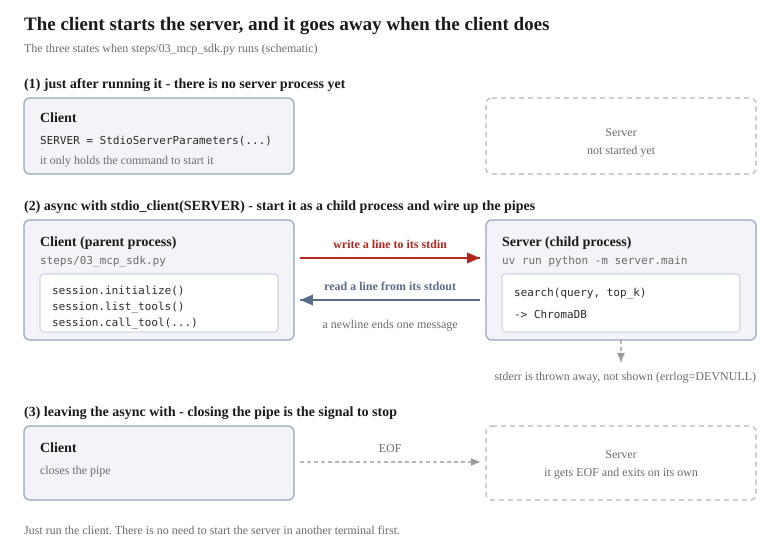

# Writing MCP with the SDK


In the previous chapter we followed the four exchanges as raw JSON-RPC. Let's write the same thing with the official SDK.


## Writing the server

It is `src/server/main.py`. Per tool, this is all that is needed
(three are actually registered, but here only `search` is extracted).

```python
from mcp.server.mcpserver import MCPServer

mcp = MCPServer("rag-search-server")

@mcp.tool()
def search(query: str, top_k: int = 5) -> str:
    """
    Search the documents of a cafe called The Wandering Kettle.

    Use this to answer questions about the menu, prices, opening hours,
    location, wifi and power sockets, allergies and dietary options, the
    staff handbook, and the history of the shop.
    """
    ...

if __name__ == "__main__":
    mcp.run()
```

**A function with `@mcp.tool()` attached becomes a tool as it is.**

What "becomes a tool" means here is that **the response to `tools/list` is built automatically from the function**.
In the previous chapter, this response came back.

```json
{
  "name": "search",
  "description": "Search the documents of a cafe called The Wandering Kettle. ...",
  "inputSchema": {
    "type": "object",
    "properties": {
      "query": {"type": "string",  "title": "Query"},
      "top_k": {"type": "integer", "title": "Top K", "default": 5}
    },
    "required": ["query"]
  }
}
```

This JSON is written nowhere. It is assembled from the `search` above.

| Contents of the response | Where in the function it came from |
|-----------|-------------------|
| `"name": "search"` | The function name `def search(...)` |
| `"description"` | The docstring |
| `query` / `top_k` in `properties` | The argument names |
| `"type": "string"` / `"integer"` | The type hints `query: str` / `top_k: int` |
| `"title": "Query"` | Attached automatically from the argument name (for display) |
| `"default": 5` | The default value `top_k: int = 5` |
| `"required": ["query"]` | The arguments that have **no** default value |

`top_k` has a default value, so it does not go into `required`.
**Write no type hints, and the `type` cannot be determined, and the tool breaks.**

> [!TIP]
> **What the decorator `@mcp.tool()` is — a Python note**
>
> A line starting with `@` is called a decorator, a mark attached to the function right after it.
> `search` itself remains an ordinary Python function, and nothing about how it is written changes.
> Add one line above it, and it comes to mean "expose this function as an MCP tool".
> It is the same idea as writing `@app.route("/search")` in a web framework to turn a function into a URL.
>
> Because how the function is written becomes the specification as it is, there are rules when writing a tool.
>
> - **Attach type hints to the arguments.** Leave them out, and the `inputSchema` cannot be built
> - **Write a docstring.** It becomes the explanatory text the LLM reads (see the next NOTE)
> - **The function name becomes the tool name as it is.** With `f` or `do_it`, the LLM cannot choose it
> - **Whatever you `return` reaches the LLM as it is.** It goes into `content` in the `tools/call` response.
>   In this project we return a single piece of already formatted text
> - **Do not `print` to stdout.** That is the path of JSON-RPC. Logs go to stderr
>
> As long as you keep to the rules, the work of adding more exposed tools becomes just "write a function and attach `@mcp.tool()`".

`mcp.run()` listens over stdio. The processing we saw in the previous chapter, "reading and writing newline-delimited JSON",
is inside it.

> [!NOTE]
> **The docstring is an instruction to the LLM**
>
> It is not a comment for humans. This text is handed to the LLM as `description` and
> becomes the material for deciding **in what situations to call this tool**.
> Write not only "what it does" but "what kinds of question it can be used for".

## Writing the client

It is `steps/03_mcp_sdk.py`.

One thing before reading it. **With stdio, the client starts the server as a child process**
([the previous chapter](06-mcp-protocol.md#the-transport-is-standard-input-and-output)). There is no need to bring the server up
first in another terminal. **Run the client, and the server starts inside it.**

The code that does this is as follows.

```python
from mcp import ClientSession, StdioServerParameters
from mcp.client.stdio import stdio_client

# ① Write down how to start the server. Nothing is started here yet
SERVER = StdioServerParameters(
    command="uv",
    args=["run", "python", "-m", "server.main"],
)

# ② Start it and have the conversation
async with stdio_client(SERVER) as (read, write):
    async with ClientSession(read, write) as session:
        info = await session.initialize()
        tools = (await session.list_tools()).tools
        result = await session.call_tool("search", {"query": "can I bring a dog", "top_k": 1})
```

**①'s `StdioServerParameters` merely writes down the startup command.**
Join `command` and `args` together and it becomes `uv run python -m server.main`.
It is the same command you would type to start the server by hand.

**②'s `stdio_client` actually starts that command as a child process.**
It corresponds to the part where we wrote `subprocess.Popen` in the previous chapter.
The started child process's standard input and output are `read` / `write`, and `ClientSession` pours JSON-RPC into them.

The remaining 3 lines are the conversation.

```python
info = await session.initialize()
tools = (await session.list_tools()).tools
result = await session.call_tool("search", {"query": "can I bring a dog", "top_k": 1})
```

- `initialize()` opens the connection. **Without calling this, you cannot call anything else** (previous chapter)
- What `list_tools()` returns is not the list itself but **an object wrapping it**.
  The array of tools is taken out with `.tools`
- To `call_tool()` you pass **the tool name** and **a dictionary of arguments**. The arguments follow the `inputSchema`.
  They are the same as what we put in `params`' `name` and `arguments` in the previous chapter

All of them have `await` attached. That is because **they wait until the response comes back**.

> [!TIP]
> **`async` and `await` — a Python note**
>
> The MCP SDK's client API is entirely **asynchronous**.
> That is because the processing writes one line into a pipe and waits until one line of reply arrives.
>
> There are only three things to remember in order to use it.
>
> - **Call with `await` attached.** Forget it, and what comes back is not the result but "a reservation to run",
>   and no communication happens
> - **`await` can only be written inside an `async def`.** That is why this whole processing is
>   put inside `async def main()`
> - **An `async def` function does not run just by being called.** Start it with `asyncio.run(main())`
>
> ```python
> async def main():
>     ...
>     info = await session.initialize()
>
> asyncio.run(main())
> ```
>
> `async with` is also the same as `with`: it cleans up when leaving the block.
> The only difference is that there is waiting time in that cleanup too.
>
> "You can get other work done while waiting" is the advantage of being asynchronous, but
> **in this material we only wait for things one at a time in order**, so we are not using that benefit.
> You can think of it as matching the way the SDK is written.

Leave the `async with`, and the connection closes and the server exits too.
The previous chapter's `proc.stdin.close()` does not need to be written.

**Lining up in order what happens to ① and ② at runtime, it looks like this.**
The numbers in the figure correspond to the numbers in the code comments.



At the point of ①, the server's process does not exist yet.
It starts for the first time at ②, and disappears when the `async with` is left at ③.

In the actual code, two arguments are added.

```python
SERVER = StdioServerParameters(..., env=dict(os.environ))
async with stdio_client(SERVER, errlog=subprocess.DEVNULL) as (read, write):
```

| Argument | Why it is needed |
|------|-----------|
| `env` | Passes environment variables to the child process. Without `RAG_CHROMA_PATH` it cannot find the database |
| `errlog` | Where the server's stderr goes. By default it appears on screen, so we throw it away to make things readable |

Let's run it.

```bash
docker compose exec app uv run python steps/03_mcp_sdk.py
```

```
[1] session.initialize()
    server   : rag-search-server
    version  : 2025-11-25

[2] session.list_tools()
    name     : search
    arguments: ['query', 'top_k']
    required : ['query']
    name     : list_documents
    arguments: []
    required : []
    name     : get_document
    arguments: ['name']
    required : ['name']

[3] session.call_tool()
    is_error : False
    content  : 1 block(s), type text
    text     : 1689 characters
    first    : [1] source: faq.txt (distance: 0.21)
```

## Four exchanges become three calls

| The previous chapter's message | The call in the SDK |
|----------------|----------------|
| `initialize` | `session.initialize()` |
| `notifications/initialized` | **Included** in the above |
| `tools/list` | `session.list_tools()` |
| `tools/call` | `session.call_tool(name, arguments)` |

**② has disappeared.** `initialize()`, after sending the request and receiving the response,
goes on to send the notification as well. There is no longer any worry about forgetting the message with no reply.

## What the SDK does on your behalf

| What we wrote ourselves in the previous chapter | In the SDK |
|-----------------|---------|
| Starting the server with `subprocess.Popen` | `stdio_client` starts it |
| `json.dumps` / `json.loads` | Not needed |
| Numbering `id` as 1, 2, 3 | Numbered automatically and matched up with the responses |
| Sending the notification and taking care **not to receive** | Included in `initialize()` |
| Finishing with `proc.stdin.close()` | It closes when you leave the `async with` |

In terms of line count, it goes **from 229 lines to 87 lines**.

## The return values are typed objects, not dictionaries

In raw JSON, everything was a dictionary.

```python
result["result"]["content"][0]["text"]     # previous chapter
```

The SDK returns typed objects.

```python
result.content[0].text                     # this chapter
```

The attributes used in this project are as follows.
**On the left is the JSON key we saw in the previous chapter, and on the right is the attribute that reads it.**

**`session.initialize()` → `InitializeResult`**

| The previous chapter's JSON | Attribute | Contents |
|------------|------|------|
| `serverInfo.name` | `.server_info.name` | The server name |
| `protocolVersion` | `.protocol_version` | The agreed version |
| `capabilities` | `.capabilities` | What the server can do |

**`session.list_tools()` → `ListToolsResult`**

| The previous chapter's JSON | Attribute | Contents |
|------------|------|------|
| `result.tools` | `.tools` | A list of `Tool` |
| `name` | `.tools[0].name` | The tool name |
| `description` | `.tools[0].description` | The description |
| **`inputSchema`** | `.tools[0].input_schema` | The argument definitions |

**`session.call_tool(name, arguments)` → `CallToolResult`**

| The previous chapter's JSON | Attribute | Contents |
|------------|------|------|
| `content` | `.content` | A list of `TextContent` |
| `type` | `.content[0].type` | The kind (`"text"`) |
| `text` | `.content[0].text` | The body |
| `isError` | `.is_error` | Whether the tool failed |

There is the advantage that a mistyped key is caught before running.

> [!NOTE]
> **Python's attribute names and the keys that actually flow as JSON are different things**
>
> `Tool`'s attribute is `input_schema`, but the JSON key is `inputSchema`.
> The attribute names merely became more Pythonic in SDK v2; **what the specification decides is the JSON side**.

## What we have learned so far

- A function with `@mcp.tool()` attached becomes a tool as it is
- `description` is built from the docstring, and `inputSchema` from the **type hints**
- The SDK takes over starting the process, JSON conversion, `id` management, the notification, and the shutdown handling
- Four messages become three calls. The notification is included in `initialize()`
- The return values are typed objects, not dictionaries

In the next Step 4, we **put the LLM on top**. We hand the tool definitions to the LLM and
let the LLM decide which tool to call. That is where RAG is completed.
