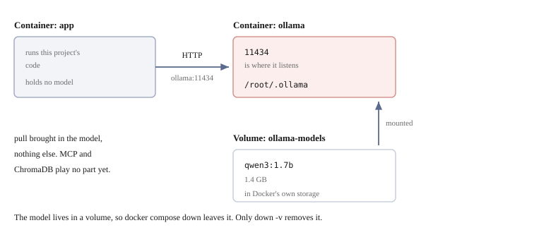
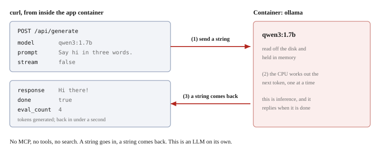

# Setting up Ollama


Ollama is already in `docker-compose.yml`. **No installation is needed.**
All there is to do is **download one model**.

## What is Ollama

It is **software for running an LLM on your own machine**.
It downloads a model and makes it possible to query it over HTTP.

**Neither an API key nor any communication to the outside is needed.** Nothing you type is sent anywhere.
This material uses Ollama because we want everything to stay local.

Ollama itself is not an LLM. It is **a vessel that runs models**.
The model you want to use is specified by name and downloaded by you.

## It is running as a service

```yaml
services:
  ollama:
    image: ollama/ollama:latest
    volumes:
      - ollama-models:/root/.ollama
```

At the point you ran `docker compose up -d`, it started together with `app`.

```bash
docker compose ps
```

```
SERVICE   STATUS
app       Up 3 minutes
ollama    Up 3 minutes
```

Let's check that it is reachable from `app`.

```bash
docker compose exec app curl -s http://ollama:11434/api/version
```

```json
{"version":"0.40.2"}
```

The reason it can be looked up by the name `ollama` is that **the service name becomes the hostname as it is**.

## Downloading a model

Nothing is in there yet.

```bash
docker compose exec ollama ollama list
```

```
NAME    ID    SIZE    MODIFIED
```

Download it.

```bash
docker compose exec ollama ollama pull qwen3:1.7b
```

It is 1.4GB, but finishes in about 26 seconds (depending on the connection).

```bash
docker compose exec ollama ollama list
```

```
NAME          ID              SIZE      MODIFIED
qwen3:1.7b    8f68893c685c    1.4 GB    24 seconds ago
```

Let's also check that it is visible from `app`.

```bash
docker compose exec app curl -s http://ollama:11434/api/tags
```

```json
{"models":[{"name":"qwen3:1.7b", ...}]}
```

At this point, the state is as follows.



**What came in is only the model's files.** The `ollama` container was running all along, and
`pull` added 1.4 GB to its storage place (the volume).

### Why `qwen3:1.7b`

`1.7b` means 1.7 billion parameters, which puts it in **the small category**.
It runs on a CPU, and the download is only a little over 1GB.
The bigger the model, the smarter, but the more memory and time it eats.
**The purpose of this material is to see how things work, so something small is enough.**

That said, it is not the case that anything small will do. In this material
we let the LLM decide "which tool to call", so
**a model that supports tool calling** is required.
Hand them to a model that does not support it, and it will ignore the tool definitions and answer however it likes.

`qwen3` supports it. If you swap it out, check whether it is supported.

## The model stays in a volume

```bash
docker compose exec ollama du -sh /root/.ollama
```

```
1.3G	/root/.ollama
```

**Ollama itself does not know about the volume.** It is merely writing to its own data storage place
called `/root/.ollama`. Over that, `docker-compose.yml` drapes a named volume.

```yaml
  ollama:
    volumes:
      - ollama-models:/root/.ollama
```

From Ollama's point of view it is an ordinary directory, but its substance lies not in the container's
writable layer but inside the volume ([chapter 2](02-docker-basics.md)). That is why **even if you delete the
container with `docker compose down`, the model remains.** There is no need to download it again.

```bash
docker compose down -v    # use this, and it is deleted
```

## Let's run it

Let's hit it directly over HTTP. Without going through MCP or the client.

```bash
docker compose exec app curl -s http://ollama:11434/api/generate -d '{
  "model": "qwen3:1.7b",
  "prompt": "Say hi in three words.",
  "stream": false,
  "think": false
}'
```

```json
{"response":"Hi there!", "done":true, "eval_count":4, ...}
```

It comes back in less than a second. **That is the end of the preparation.**



**There is only one round trip.** Put a string in `prompt` and send it, and
a string comes back in `response`. In between, the model is loaded and the following words are computed.

`eval_count` is the number of **tokens** (units finer than words) generated.
Here it made only 4, so it comes back in an instant, but have it write a long text, and
it takes time in proportion to that number.

> [!NOTE]
> **`think` is set to false**
>
> Leave it out, and `qwen3` returns its thinking process too. In measurements from throwing this
> question several times, with `think: false` it was stable at 0.7 seconds and 7 tokens, whereas
> leaving it out varied from 55 seconds to 313 seconds (314 to 1470 tokens).
> Here we only want to see the shape of the response, so it is turned off.

## Ollama's API is not JSON-RPC

It is **an entirely different agreement** from the MCP we saw in chapters 6 and 7. It uses the same JSON, so
it is easy to confuse them, but that is the only thing they have in common.

| | MCP server | Ollama |
|---|---|---|
| Transport | Standard input and output | HTTP |
| Format | JSON-RPC 2.0 | Plain JSON (the POST body) |
| How what to call is specified | `method` (inside the message) | **The URL path** |
| Startup | The client starts it as a child process | You connect to something already running |
| Starting the connection | `initialize` is required | None. You POST right away |
| `id` | Required. Matches up with the response | None. The HTTP response is the reply |
| State | The session continues | Each time is one-off |

**On Ollama's side there is no agreement to speak of.** POST JSON to a URL, and
JSON comes back. That is all. There is nothing corresponding to chapter 6's "four exchanges".

### The URL is what corresponds to MCP's `method`

In this chapter we hit three URLs.

| URL | What it does |
|-----|-----------|
| `/api/version` | Returns the version |
| `/api/tags` | Lists the downloaded models |
| `/api/generate` | Hands over a prompt and has text written |

**What was written in `method` in MCP has become the URL here.**

```
MCP     {"jsonrpc": "2.0", "id": 2, "method": "tools/list"}
Ollama  POST /api/tags
```

Both are the specification of "what to call", and **only the place they are put differs**.
MCP pours all its messages through a single connection, so the name had to be written inside.
Ollama is a separate HTTP request each time it is called, so the URL is enough.

Every URL is independent. There is no ordering rule such as calling `/api/version` before calling `/api/generate`.

What the client actually uses is one more, `/api/chat`.
It exchanges things in the form of a conversation, and **the list of tools can be handed over too**. Using that is Step 4.

## Using a different model

It can be changed with an environment variable. Write it in `.env`.

```bash
OLLAMA_MODEL=qwen3:4b
```

`src/server/config.py` reads this. The default is `qwen3:1.7b`.

Do not forget to download it.

```bash
docker compose exec ollama ollama pull qwen3:4b
```

**Choose a model that supports tool calling** ([above](#why-qwen317b)).

## Using the Ollama on the host

If you are already running Ollama on the host, you may use that one.
It saves you from having the model twice.

Write it in `.env`.

```bash
OLLAMA_HOST=http://host.docker.internal:11434
```

`host.docker.internal` is a name that points to the host itself.
On Linux it cannot be resolved by default, so it is added in `docker-compose.yml`.

```yaml
    extra_hosts:
      - "host.docker.internal:host-gateway"
```

Let's check that it can be resolved.

```bash
docker compose exec app getent hosts host.docker.internal
```

```
172.17.0.1      host.docker.internal
```

> [!WARNING]
> **The Ollama on the host needs its listening address changed**
>
> By default Ollama listens only on `127.0.0.1`. **It is not reachable from the container.**
> On the host side, set `OLLAMA_HOST=0.0.0.0` and **restart Ollama**.
>
> The same name, `OLLAMA_HOST`, appears here with two meanings.
>
> | Where it is written | Value | Meaning |
> |---------|---|------|
> | This project's `.env` | `http://host.docker.internal:11434` | The URL of **what to connect to** |
> | The host side's Ollama | `0.0.0.0` | The address **to listen on** |
>
> Set it to `0.0.0.0`, and it becomes reachable from other machines on the same network too.

## When you run into trouble

### You get `connection refused`

The `ollama` service is not running.

```bash
docker compose ps
docker compose up -d
```

### It says `model not found`

You have not downloaded it. Check the name too.

```bash
docker compose exec ollama ollama list
```

### No response comes back

It is running on the CPU, so a large model takes time.
Try `qwen3:1.7b` first.

> [!NOTE]
> On macOS, the Apple Silicon GPU cannot be handed to a container.
> Ollama inside the container does **CPU inference**.
> If you need speed, use the Ollama on the host (above).

## What we have learned so far

- Ollama starts together with everything else on `docker compose up -d`. No installation needed
- All there is to do is download one model with `ollama pull`
- The model stays in a volume and does not disappear with `down`
- The Ollama on the host can also be used, via `.env`
- **The API is not JSON-RPC.** POST JSON to a URL and JSON comes back, that is all; there is no
  `initialize`, no `id`, and no session

We have come to the point where Ollama runs on its own. However, this is **just an LLM, and it knows neither MCP nor the search**.
In the next chapter, we look at how to combine it with the MCP server.
