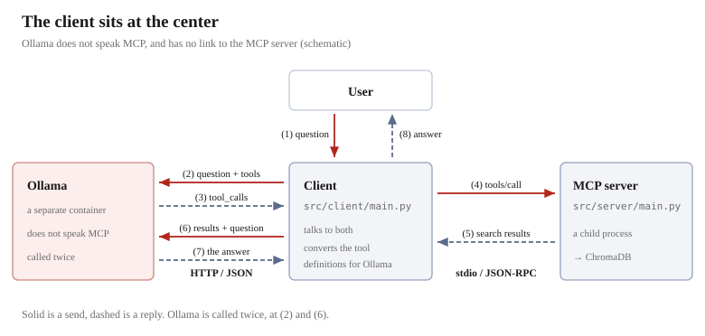
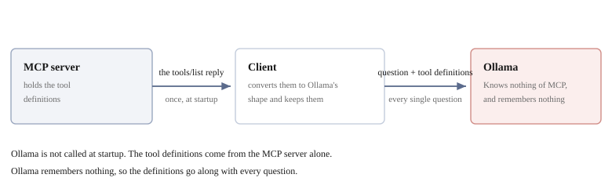
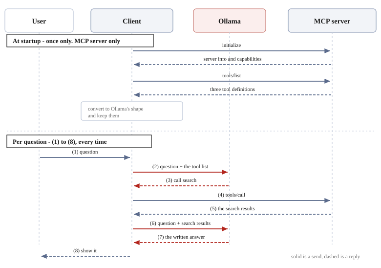

# The relationship between MCP and Ollama


We can now call tools from another process, and Ollama runs too.
What remains is **letting the LLM decide which tool to call and how**.

In this chapter we look at how those two fit together. Running it is the next chapter.

## The structure of the whole

Three processes appear.



| | Role | Who it talks to |
|---|------|---------|
| **Client** | Drives the whole thing | Both Ollama and the MCP server |
| **MCP server** | Provides the tools | The client only |
| **Ollama** | Decides which tool to call, and writes the answer | The client only |

**The client is at the center.** Ollama and the MCP server are not directly connected.

## Ollama does not know about MCP

This is where it is easy to misunderstand.

**Ollama does not know of the MCP server's existence, nor does it speak the MCP convention.**
It is just an LLM, nothing more than the party the client queries over HTTP at `http://ollama:11434`.

So why can it choose a tool? **Because the client tells it, every time.**



The source of the tool definitions is the MCP server. The client **receives them once with
`tools/list` when it starts**, converts them into a form Ollama can read, and keeps them.

What reaches Ollama happens after that. **With every question, it sends along the tool definitions it holds.**
From Ollama's point of view, it is merely choosing from a list of functions it was handed,
and it does not know what is on the other side of them.

### Converting the format

MCP and Ollama have different shapes for tool definitions. The client repacks them.

```python
def mcp_tools_to_ollama_format(mcp_tools):
    return [{
        "type": "function",
        "function": {
            "name": tool.name,
            "description": tool.description,
            "parameters": tool.input_schema,
        }
    } for tool in mcp_tools]
```

| | MCP | Ollama |
|---|-----|--------|
| Name | `name` | `function.name` |
| Description | `description` | `function.description` |
| Argument definitions | `inputSchema` | `function.parameters` |

**The contents are the same JSON Schema.** Only the names of the containers differ, so the repacking is mechanical.

## What happens for a single question

**When it started, the client received the list of tools.**
A three-piece set of name, `description`, and `inputSchema` is on hand, as many times as there are tools.

When a question comes in, ① through ⑧ happen in order.



**The four at startup happen only once, and ① through ⑧ happen with every question.**
The client waits while holding the tool list, and every time a question comes, it sends it along at ②.

In code it is 3 lines.

```python
response = call_llm(user_input, tools=ollama_tools)        # ②③
result   = await session.call_tool(func_name, func_args)   # ④⑤
answer   = generate_answer(context=search_result, ...)     # ⑥⑦
```

### Ollama is called twice

At ② and at ⑥. What is handed over, and what is asked for, both differ.

| | What is handed over | What comes back |
|---|---------|--------------|
| ② | The question + the tool list | "Call `search` with these arguments" |
| ⑥ | The question + **the search results** | The text of the answer |

**These two are separate queries.** Ollama does not remember ②, so
at ⑥ the question is written out and sent again. The search results are embedded in that body.
It is not returning a result as "a continuation of ②".

### The one that executes is the client

What comes back at ③ is **an instruction to call**, not an execution result.
**Ollama cannot execute anything.** It can neither read files nor does it know about ChromaDB.

```json
{"function": {"name": "search", "arguments": {"query": "can I bring a dog"}}}
```

`name` is chosen from the list handed over at ②. `arguments` is assembled by the LLM
following the `inputSchema`. **④ just passes this to `tools/call` as it is.**

## How does the LLM choose

This server has three tools (chapter 6).
At ②, **the definitions of all three tools are sent along with the question**. They are not selected before sending.
And what comes back at ③ is **the name of one of them**.

```
Question: Can I bring my dog?             -> search({"query": "can I bring a dog", "top_k": 5})
Question: What documents can you search?  -> list_documents({})
Question: Show me faq.txt in full.        -> get_document({"name": "faq.txt"})
```

**What is handed over is the same three every time, yet the name that comes back changes.**
The only thing that differs is the question.

**The only material for the judgment is `description`.** The client merely sent the question and the definitions;
it is not involved at all in judging which one fits.

| Who | What they have |
|------|----------------|
| MCP server | The tools' **substance** (the functions) |
| Client | The tools' **definitions** (what it received with `tools/list`) |
| Ollama | **Only gets shown the definitions, every time.** It does not know the substance |

`description` is the docstring of the function with `@mcp.tool()` attached (chapter 7).
**How the docstring is written becomes the accuracy of the selection, directly.**
Listing "menu, opening hours, allergies" in `search`'s docstring is
not an explanation for humans, but material for this judgment.

> [!NOTE]
> **Sometimes it cannot choose**
>
> `qwen3:1.7b` is a small model. It can distinguish the three above stably, but
> for a question that fits none of the tools, it sometimes answers without calling a tool.
> If `tool_calls` is empty, the client displays that body as it is.

## This is RAG

The documents taken out at ⑤ are handed to the LLM at ⑥. This shape has a name.
It is **RAG — Retrieval-Augmented Generation**.

```
R  Retrieval    ⑤ search and take things out   (built in the chapters up to now)
A  Augmented    ⑥ add them to supplement the question
G  Generation   ⑦ have the answer written
```

It means "**supplement** the question with what was taken out, then have it written".

**RAG is the name of the assembled shape.** The result of stacking ChromaDB → MCP → LLM
is itself what is called RAG.

## What we have learned so far

- The client is at the center. Ollama and the MCP server are not directly connected
- **Ollama does not know about MCP.** The tool definitions are handed over by the client every time
- **The one that decides which to call is the LLM.** The only material for the judgment is `description`
- The definitions' format needs converting. The JSON Schema inside is the same
- **Ollama is called twice.** The first time is the judgment, the second time is the writing
- The one that executes the tool is the client. The LLM only returns an instruction

In the next chapter's Step 4, we actually run it.
