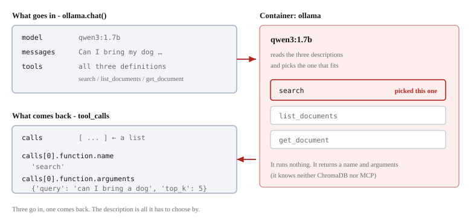

# Completing RAG


Let's put the last part on. Up to here, it went as far as searching and **taking things out**.
We hand the retrieved documents to the LLM and **have it write the answer**.

```bash
docker compose exec app uv run python steps/04_rag.py
```

It is assumed that you have downloaded the model in [Setting up Ollama](08-ollama-setup.md).

## Running it

```
Question: Can I bring my dog to the cafe?

[1] tools from the server: ['search', 'list_documents', 'get_document']

[2] asking the LLM what to do
    it asked for: search({'query': 'can I bring a dog', 'top_k': 5})

[3] calling the tool through the MCP server
    got 7401 characters back

[4] asking the LLM to answer from them

========================================================================
Answer
========================================================================
Yes, you can bring your dog to the cafe. The passage states that dogs are
welcome on the small terrace at the top of the stairs, but not inside the
room itself. There is a water bowl by the terrace door, and assistance
animals are welcome anywhere.
```

The whole thing takes from one minute to several minutes. **Most of the waiting is [2] and [4]**, that is, the LLM.
In one run, 210 of the total 227 seconds were those two ([3], the search, takes less than a second).

Since inference runs on the CPU, **it varies greatly with the machine and how busy it is at the time**.
The same command can finish in a minute, or take several minutes.

**The answer that comes back is exactly what is written in the material.** The terrace is allowed, inside is not, there is a water bowl,
and assistance animals are allowed anywhere. It is the `ANIMALS` section of `faq.txt` as it is.

## What happens without the search

Let's throw the same question directly at the LLM, without the search.

```
Yes, you can bring your dog to The Wandering Kettle, but there are a few
things to keep in mind:

1. **Pet Policies**: Check the cafe's policies regarding pets. Some cafes
   may allow pets, others may require a pet license or fee, ...

2. **Size and Space**: If the cafe has a small space or limited seating
   for pets, you m...
```

**It can only speak in generalities.** This shop is fictional, so the LLM has no way of knowing.
Even so, it answers "Yes" and lines up plausible-sounding caveats.

This contrast is the worth of RAG. **It keeps it from answering about things it does not know as if it did.**

## Reading the code

It is `steps/04_rag.py`. It uses nothing that has not already appeared in the previous chapters.

### Repacking the tool definitions

```python
def to_ollama_format(tools):
    return [{
        "type": "function",
        "function": {
            "name": tool.name,
            "description": tool.description,
            "parameters": tool.input_schema,
        },
    } for tool in tools]
```

What `session.list_tools()` returned is rearranged into Ollama's shape.
The JSON Schema inside stays as it is.

### The first call — having it decide what to do

```python
decision = ollama.chat(
    model=MODEL,
    messages=[{"role": "user", "content": QUESTION}],
    tools=ollama_tools,
)

calls = decision.message.tool_calls
name = calls[0].function.name
arguments = calls[0].function.arguments
```

**The question and the tool definitions are handed over together.** What comes back is `tool_calls`,
the instruction "call `search` with these arguments".



`decision.message.tool_calls` is **a list**. Take one item out of it, and it looks like this.

```python
>>> calls = decision.message.tool_calls
>>> calls
[ToolCall(function=Function(name='search', arguments={'query': 'can I bring a dog', 'top_k': 5}))]

>>> calls[0].function.name
'search'
>>> calls[0].function.arguments
{'query': 'can I bring a dog', 'top_k': 5}
```

`name` is the name of the tool to call, and `arguments` are its arguments.
It is in exactly the shape you can pass to `session.call_tool(name, arguments)`.

> [!NOTE]
> **The default value is sometimes filled in and sometimes not**
>
> `top_k: 5` is not written in the question. It is the `inputSchema`'s default value, written in by the LLM.
> However, not every time. Throwing the same question 6 times, `top_k` was included 4 times.
>
> ```python
> {'query': 'can I bring a dog', 'top_k': 5}
> {'query': 'can I bring a dog'}
> ```
>
> Being left out causes no trouble. **The default value is held by the function on the server side**, so
> if `top_k` is absent, the 5 in `def search(query: str, top_k: int = 5)` is used.

> [!NOTE]
> **`tool_calls` is sometimes empty**
>
> When the LLM judges that it will answer without using a tool, `tool_calls` becomes `None`.
> Only the body comes back, so we display it as it is.
>
> ```python
> if not calls:
>     print(decision.message.content)
>     return
> ```

### Calling the chosen tool, via MCP

The `name` and `arguments` that came back from the first call are passed **as they are**.

```python
result = await session.call_tool(name, arguments)
passages = result.content[0].text
```

The client is not interpreting the contents. It merely forwarded the name and arguments the LLM stated.
**It is here that ChromaDB runs for the first time** (the `tools/call` we saw in chapters 6 and 7).

The body is taken out of the returned `CallToolResult`.

```
result.content      a list of 1 item
result.content[0]   type is "text"
passages            7401 characters
```

These 7401 characters are exactly the string the server's `search()` returned.
Since `top_k` is 5, **5 items' worth is strung together into one piece of text**.

```
[1] source: faq.txt (distance: 0.21)
[2] source: allergens.txt (distance: 0.23)
[3] source: menu_drinks.txt (distance: 0.24)
[4] source: menu_food.txt (distance: 0.25)
[5] source: hours_access.txt (distance: 0.25)
```

### Embedding the search results in the question text

This is the part that corresponds to RAG's **A** (Augmented).

```python
prompt = (
    "Answer the question using only the reference material below.\n\n"
    f"[Reference]\n{passages}\n\n"
    f"[Question]\n{QUESTION}\n\n"
    "[Answer]"
)
```

What gets assembled is a single string like this (7529 characters in total).

```
Answer the question using only the reference material below.

[Reference]
[1] source: faq.txt (distance: 0.21)
passage:
                              ← the 7401 characters of search results (5 items) go in here
[Question]
Can I bring my dog to the cafe?

[Answer]
```

**`[Reference]` and `[Question]` are just markers.** They are not a fixed format.
It is enough if the LLM gets the message "from here is the material, from here is the question".

### The second call — having the answer written

```python
answer = ollama.chat(model=MODEL, messages=[{"role": "user", "content": prompt}], think=False)
```

**`tools` is not handed over.** That is because what we want is not a judgment but writing.

The reason `using only the reference material` is written is
**to keep it from filling in with its own knowledge**. Having generalities like the ones above mixed in would be a problem.

> [!NOTE]
> **`think=False` is attached only to the second call**
>
> Leave it out, and `qwen3` returns its thinking process too, taking about 20 extra seconds.
> That would seem to argue for turning it off always, but **turning it off on the first call makes it fail to pick the tool**.
> These are the results of throwing four kinds of question six times each.
>
> ```
>                        tool_calls returned
> think omitted                 24/24
> think=False                   20/24
> ```
>
> It is turned off only on the second call, where there is nothing to choose.

## What got assembled

```
[1] tools/list        ask what tools the server has                  ← Step 2, 3
[2] the LLM judges    decide which tool to call
[3] tools/call        query ChromaDB                                 ← Step 1, 2
[4] the LLM writes    write the answer from the retrieved documents
```

Lining up which lines of code correspond to the three stages of RAG we saw in the previous chapter (chapter 9), it looks like this.

| | Code | Stage |
|---|-------|------|
| [3] | `session.call_tool(name, arguments)` | **R**etrieval |
| | `f"[Reference]\n{passages}..."` | **A**ugmented |
| [4] | `ollama.chat(messages=[...prompt...])` | **G**eneration |

**A is not even a function call.** It is merely assembling a string.
What lies at the center of RAG is not a special mechanism but **this concatenation**.

## What we have learned so far

- The `name` and `arguments` returned by the first call can be passed to `call_tool()` **as they are**
- The search results go into `content[0].text`. It is exactly `search()`'s return value
- **A (Augmented) is really just string concatenation.** `[Reference]` is not a format, just a marker
- The second call does not hand over the tool definitions, because what is wanted is writing, not a judgment
- `using only the reference material` keeps it from mixing in its own knowledge
- Without the search, it answers **plausible lies** about a fictional shop

## What comes next

In `src/` there is a finished version that does the same thing interactively.
In the next chapter, we run it interactively.
