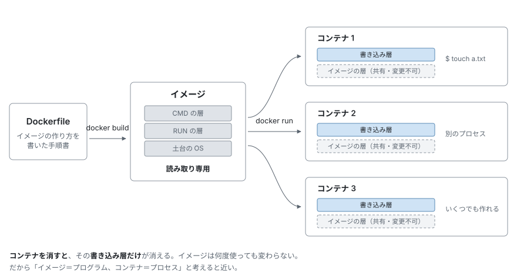

# Docker 入門


前章で Docker が動作するようになった。この章では、Docker そのものの考え方を扱う。
Docker に慣れているなら、飛ばして [動く環境を用意する](03-environment.md) へ進んでよい。

**このプロジェクトは出てこない。** 出てくるコマンドはすべて公開イメージを使った
数行の例で、Docker さえ入っていれば手元でそのまま実行できる。
ここで扱う語彙——コンテナ、イメージ、層、ボリューム、Compose——は、
次章以降で説明なしに使う。

## コンテナとは何か

「軽い仮想マシン」という説明をよく見るが、正確ではない。
実際に動かして、何が違うのかを確かめる。

```bash
docker run --rm ubuntu:24.04 ps -ef
```

最初のコマンドなので、各部分が何を指すかを並べておく。

| 部分 | 意味 |
|------|------|
| `docker run` | イメージからコンテナを作って動かす |
| `--rm` | **終了したら、そのコンテナを自動で削除する** |
| `ubuntu:24.04` | 使うイメージ |
| `ps -ef` | コンテナの中で動かすコマンド |

`--rm` を付けないと、終了したコンテナが停止状態で残り続け、
`docker ps -a` に溜まっていく。使い捨てで試すときは付けておく。

出力は次のようになる。

```
UID          PID    PPID  C STIME TTY          TIME CMD
root           1       0 20 15:18 ?        00:00:00 ps -ef
```

プロセスが1つしかない。PID 1 は、いま実行を指示した `ps -ef` そのものである。

仮想マシンなら、カーネルが起動し、init が上がり、デーモンが並ぶ。
ここにはそれがない。**指定したコマンドが1つ動いているだけ**である。

では、コンテナとは何なのか。次の2つを確かめると輪郭がはっきりする。

### 共有されているもの — カーネル

ホストが Ubuntu のマシンで、**Alpine Linux** のコンテナを動かしてみる。
Alpine は Ubuntu とは別のディストリビューションである。

```bash
docker run --rm alpine:3.20 sh -c '. /etc/os-release; echo $PRETTY_NAME'
docker run --rm alpine:3.20 uname -r
```

```
Alpine Linux v3.20
7.0.0-30-generic
```

ホスト側でも同じことを聞いてみる。

```bash
. /etc/os-release; echo $PRETTY_NAME
uname -r
```

```
Ubuntu 24.04.4 LTS
7.0.0-30-generic
```

**ディストリビューションは違うのに、カーネルは同じ**である。

コンテナは自分のカーネルを持たない。ホストのカーネルをそのまま使い、
その上に別のディストリビューションのファイル一式を被せているだけである。
`/etc/os-release` が Alpine と答えるのは、Alpine のファイルが見えているからにすぎない。

イメージを変えても、この答えは変わらない。

```bash
for img in ubuntu:24.04 alpine:3.20 debian:12-slim ubuntu:20.04; do
  docker run --rm $img uname -r
done
```

```
7.0.0-30-generic
7.0.0-30-generic
7.0.0-30-generic
7.0.0-30-generic
```

4つとも、ホストのカーネルである。**どのイメージを選んでも変わらない。**
最後の `ubuntu:20.04` は 2020 年のディストリビューションだが、
それでもホストの新しいカーネルを報告する。
**イメージが決めるのはファイル一式だけで、カーネルではない。**

逆に言えば、カーネルに強く依存するものはイメージでは解決できない。
古い `ubuntu:20.04` を持ってきても、動いているカーネルは新しいままである。

> [!NOTE]
> **macOS / Windows の場合**
>
> Docker Desktop は Linux の仮想マシンを1つ動かし、その中でコンテナを動かす。
> 共有されるのは**その仮想マシンのカーネル**である。
>
> ```
> macOS 自身のカーネル : 25.6.0
> コンテナ内の uname -r: 6.12.76-linuxkit
> ```
>
> 「ホストのカーネルを共有する」という話は変わらないが、
> ここでの「ホスト」は macOS ではなく、その仮想マシンを指す。

仮想マシンとの違いはここにある。仮想マシンは自前のカーネルを起動するので、
起動に時間がかかり、メモリも確保する。コンテナにはその工程がない。

### 制限されているもの — 見える範囲

`sleep 300` のプロセスを1つ起動し、その **PID（プロセス番号）を
コンテナの中とホスト側の2か所で調べる。** 調べる対象は同じ1つのプロセスである。


```bash
docker run -d --name demo ubuntu:24.04 sleep 300

# どちらもホストの端末で打つ
docker exec demo ps -ef                    # コンテナの中での PID
docker inspect -f '{{.State.Pid}}' demo    # ホスト側での PID
```


1つ目の `docker exec` は、打つのはホストだが、
実行されるのはコンテナの中である。

2つ目の `.State.Pid` が返すのは、**コンテナが起動したプロセス1つ分のホスト側の PID** である。
このコンテナで動いているのは `sleep 300` だけなので、それがそのまま返る。

ここで新しい指定が2つ出てくる。

| 部分 | 意味 |
|------|------|
| `-d` | バックグラウンドで動かし、すぐプロンプトに戻る |
| `--name demo` | コンテナに `demo` という名前を付ける |

`sleep 300` を選んだのは、**終了せずに動き続けてもらう**ためである。
`ps -ef` のようにすぐ終わるコマンドでは、PID を調べる前に消えてしまう。

結果はこうなる。

```
コンテナの中での PID: 1
ホスト側での PID    : 37785
```

どちらも `sleep 300` の PID である。ホスト側の値は実行のたびに変わる。
大事なのは**1つのプロセスに、立場によって2つの PID が付いている**ことである。

コンテナには、PID の空間が別に用意される。その中では
自分が 1 番から数え直され、ホストからは通常のプロセスとして見える。

ここで誤解しやすいのは、**ホストのプロセスが PID を変えて見えるわけではない**
という点である。新しい空間には、そのコンテナのプロセスしか入らない。
ホスト側で何百とプロセスが動いていても、コンテナからは1つも見えない。

ホスト側の `ps` で引けば、普通に載っている。

```bash
ps -o pid,cmd -p 37785
```

```
    PID CMD
  37785 sleep 300
```

確認したら `docker rm -f demo` で片付ける。

### まとめると

コンテナとは、**ホストのカーネルの上で動く、ただのプロセス**である。
ただし Docker が、そのプロセスから見える範囲を差し替えている。

同じ項目を、ホスト側とコンテナの中で並べてみる。
Ubuntu のホストで Alpine のコンテナを動かし、両方に同じことを聞いた結果である。
ホスト側の値は環境によって変わるので、そこは内容で示した。

| 聞いたこと | ホスト側 | コンテナの中 | |
|-----------|---------|------------|---|
| `uname -r` | `7.0.0-30-generic` | `7.0.0-30-generic` | **同じ**（イメージを変えても） |
| ディストリビューション | Ubuntu 24.04.4 | Alpine Linux v3.20 | 別 |
| 見えるプロセスの数 | 218（コンテナの分も含む） | 2 | 別 |
| PID 1 は何か | `systemd` | `sleep 300` | 別 |
| `hostname` | 自分で付けた名前 | `e0a4ec4f7347` | 別 |
| IP アドレス | LAN のアドレス | `172.17.0.2` | 別 |
| `whoami` | ログインしたユーザー | `root` | 別 |
| `/home` の中身 | ログインユーザーのディレクトリ | 空 | 別 |
| ホストのファイル | 見える | **見えない** | 別 |

**同じなのはカーネルだけ**で、他はすべて別に見えている。

プロセスの行は、**PID が振り直されているのではない**点に注意したい。
ホストの 218 個がコンテナからも見えていて PID だけ違う、という話ではなく、
**コンテナからはホストのプロセスが1つも見えない**。
見えているのは自分の 2 個だけである。

```
$ docker exec demo ps -ef
PID   USER     TIME  COMMAND
    1 root      0:00 sleep 300
    8 root      0:00 ps -ef
```

2つ目は、いま実行した `ps` 自身である（PID は実行のたびに変わる）。
つまり**コンテナが動かしているプロセスは、実質1つだけ**である。

### 見えなくなるのは片側だけ

ただし、この分離は**一方通行**である。
コンテナからホストは見えないが、**ホストからコンテナは見える**。

ホストのプロセス数を、コンテナの起動前後で比べると分かる。

```bash
ps -e | wc -l      # 起動前
docker run -d --name demo alpine:3.20 sleep 300
ps -e | wc -l      # 起動後
```

```
210
218
```

増えている（実際の数はマシンの状態による）。
表にあった 218 という数字は、**コンテナのプロセスを含んだ数**だった。
実際、ホストの `ps` で探すと出てくる。

```bash
ps -ef | grep "sleep 300"
```

```
root  42167  42144  16 17:11 ?  00:00:00 sleep 300
```

コンテナの中では PID 1 だったプロセスが、ホストでは 42167 として並んでいる。
特別な扱いではなく、他のプロセスと同じ一覧に載る。

| | ホストのプロセスが見えるか | コンテナのプロセスが見えるか |
|---|---|---|
| ホストから | 見える | **見える** |
| コンテナから | **見えない** | 見える（自分の分だけ） |

コンテナは隠れているのではなく、**ホストから見られていることに気づいていない**
だけである。ホスト側からは、`kill` することも、`ps` で状態を見ることもできる。

ファイルシステムも同じである。**名前が似ていても、別の木**が見えている。

```
$ ls /                      # ホスト
bin  boot  cdrom  dev  etc  home  lib  lib64  lost+found  media  mnt  opt
proc  root  run  sbin  snap  srv  swap.img  sys  tmp  usr  var

$ docker exec demo ls /     # コンテナ
bin  dev  etc  home  lib  media  mnt  opt  proc  root  run  sbin  srv
sys  tmp  usr  var
```

`bin` や `etc` という名前は両方にあるが、中身はそれぞれの
ディストリビューションのものである。ホスト側にしかない `boot` や `snap` は、
コンテナからは存在しない。

`/home` に至っては、ホストにはログインユーザーのディレクトリがあるのに、
コンテナでは**空**である。ホスト上のファイルを指定しても見つからない。

```
$ docker exec demo ls /home/<ユーザー名>/somefile.txt
ls: /home/<ユーザー名>/somefile.txt: No such file or directory
```

**コンテナからホストのファイルは1つも見えない。** 見せたい場合は、
後述のバインドマウントで明示的に繋ぐ必要がある。

逆向きは、プロセスと同じで**見える**。さきほどの 42167 を使う。

```bash
sudo ls /proc/42167/root/
```

```
bin  dev  etc  home  lib  media  mnt  opt  proc  root  run  sbin  srv  sys  tmp  usr  var
```

`/proc/<PID>/root` は、そのプロセスから見えている `/` を指す。
コンテナの `/` がそのまま出てくる。`sudo` が要る点だけが違う。

コンテナの中の値は、どれも嘘ではない。
`1` 番のプロセスは確かに存在し、`172.17.0.2` は実際に通信できる。
**見えている世界そのものが差し替えられている**のであって、
数字が偽装されているわけではない。

カーネルが同じである以上、コンテナは自分で OS を起動していない。
起動しているのは、指示したプロセス1つだけである。

見える範囲を差し替える仕組みを **namespace**、使える CPU やメモリの量を
制限する仕組みを **cgroup** と呼ぶ。どちらも Linux カーネルの機能であり、
Docker が作ったものではない。**Docker はそれらを扱いやすくまとめた道具**である。

起動が一瞬で終わるのも、これで説明がつく。
待つべき OS の起動が、そもそも無い。

### ユーザーだけは、もう一段ややこしい

上の表で `whoami` の行は「別」だった。コンテナの中は `root`、
ホストは自分のログイン名である。

ところが**同じプロセスをコンテナとホストの両方から見ると、話が変わる**。
PID はコンテナの中で `1`、ホスト側では別の値だった。
ユーザーはどうか。

```bash
docker run -d --name demo alpine:3.20 sleep 300
docker exec demo id
```

```
uid=0(root) gid=0(root) groups=0(root),...
```

コンテナの中では UID 0、つまり root である。
では、このプロセスはホストから見て何者なのか。


```bash
ps -o uid=,pid=,cmd= -p $(docker inspect -f '{{.State.Pid}}' demo)
```


```
    0   39484 sleep 300
```

**コンテナの中でもホスト側でも UID 0** である。
PID はコンテナとホストで別の値になったのに、UID は同じ値のままになる。

つまりコンテナの中の root は、ホストの root と同一人物として扱われる。
別の値に読み替えられたりはしない。

`--user` で変えれば、それもそのまま通る。


```bash
docker run -d --name demo2 --user 1000 alpine:3.20 sleep 300
docker exec demo2 id         # uid=1000
ps -o uid= -p $(docker inspect -f '{{.State.Pid}}' demo2)
```


```
 1000
```

この場合もコンテナとホストの両方で 1000 になる。

| 同じプロセスを | コンテナの中から見ると | ホストから見ると |
|---|---|---|
| PID | `1` | `39484` ← 別の値になる |
| UID（既定） | `0` | `0` ← **同じ値** |
| UID（`--user 1000`） | `1000` | `1000` ← **同じ値** |

**PID はコンテナとホストで別の値になるのに、UID は同じ値のままである。**
これが次の警告に直結する。

> [!WARNING]
> **これがバインドマウントで効いてくる**
>
> コンテナは既定で root として動く。そのままホストのディレクトリに
> 書き込むと、**ホスト側にも UID 0 のファイルが残る**。
>
> 実際の症状は、この後の「[データを残す2つの方法](#データを残す2つの方法)」で扱う。
> 回避するには `--user` で自分の UID を指定するか、
> ボリュームを使ってホストのディレクトリに直接書かせない。

## イメージとコンテナの関係

`ubuntu:24.04` の部分が**イメージ**である。ファイルシステムの中身が
詰まった読み取り専用のテンプレートで、コンテナはそこから作られる。

関係を図にすると次のようになる。



1つのイメージから、いくつでもコンテナを作れる。

```bash
docker run -d --name demo1 ubuntu:24.04 sleep 60
docker run -d --name demo2 ubuntu:24.04 sleep 60
docker ps
```

```
demo2   ubuntu:24.04   Up Less than a second
demo1   ubuntu:24.04   Up Less than a second
```

後片付けは `docker rm -f demo1 demo2` で行う。

2つのコンテナは、同じイメージを土台にしながら別々に動く。
一方で作ったファイルが、もう一方から見えることはない。

### イメージはどこから来るのか

`ubuntu:24.04` は、あらかじめ用意したものではない。手元に無ければ、
**Docker Hub** という公開の置き場から自動で取得される。
明示的に取得することもできる。

```bash
docker pull debian:12-slim
```

```
774043ccc8cc: Pull complete
Digest: sha256:3783cc01769c7b2b1b83a5c5ad96c815348e28ed7da68e2e3687004faa906251
Status: Downloaded newer image for debian:12-slim
docker.io/library/debian:12-slim
```

最後の行が、省略せずに書いた名前である。

```
docker.io  /  library  /  debian  :  12-slim
─────────     ───────     ──────     ───────
 置き場       作った人     名前       タグ
```

普段は短く書ける。`docker.io` は既定なので省け、
`library`（Docker 公式が用意したもの）も省ける。
公式でないものは、作った人の名前が残る。

| 短い書き方 | 実際の名前 |
|-----------|-----------|
| `ubuntu:24.04` | `docker.io/library/ubuntu:24.04` |
| `alpine:3.20` | `docker.io/library/alpine:3.20` |
| `ollama/ollama` | `docker.io/ollama/ollama:latest` |

タグはバージョンを指す。省略すると `latest` になるが、
**いつの間にか中身が変わる**ので、`ubuntu:24.04` のように明示するのが確実である。

### 何を土台に選ぶか

OS のイメージだけでも複数あり、大きさが違う。


```bash
docker images --format "{{.Repository}}:{{.Tag}}\t{{.Size}}"
```


手元に取得済みのものが並ぶ。この章で触れた4つを抜き出すと、こうなる。

```
alpine:3.20	11.8MB
nginx:alpine	93MB
debian:12-slim	114MB
ubuntu:24.04	117MB
```

`alpine` が極端に小さい。最小限の構成で作られているためで、
この章で短い例に使ってきたのはそれが理由である。
一方で、`apt` が使えない、一部のソフトが動かないといった差もある。

OS とは限らない。**やりたいことが決まっているなら、それ専用のイメージがある。**

| イメージ | 中身 |
|---------|------|
| `nginx` | Web サーバーが入っていて、起動すればすぐ動く |
| `postgres` | データベース |
| `python` / `node` | 言語の実行環境 |
| `ollama/ollama` | LLM の実行環境（次章で使う） |

土台から自分で組むより、近いものを `FROM` に置いて必要な分だけ足す方が早い。
次章で読むこのプロジェクトの `Dockerfile` も、`ubuntu:24.04` を土台にしている。

## コンテナへの変更は残らない

コンテナの中で作ったファイルは、そのコンテナと共に消える。

```bash
docker run --rm ubuntu:24.04 bash -c "touch /tmp/a.txt; ls /tmp/"
```

```
a.txt
```

もう一度、別のコンテナで確認する。

```bash
docker run --rm ubuntu:24.04 ls /tmp/
```

何も出力されない。前のコンテナで作った `a.txt` は存在しない。

イメージは読み取り専用で、コンテナはその上に薄い書き込み層を重ねて動く。
コンテナを消せば、その層ごと消える。**残したいものは別の場所に置く**必要がある。
その方法は後半で扱う。


## イメージは層でできている

イメージは1枚岩ではない。変更を積み重ねた層の集まりである。


```bash
docker history ubuntu:24.04 --format "{{.Size}}\t{{.CreatedBy}}"
```


```
0B	/bin/sh -c #(nop)  CMD ["/bin/bash"]
85.1MB	/bin/sh -c #(nop) ADD file:6c214fc3c3c22122c…
0B	/bin/sh -c #(nop)  LABEL org.opencontainers.…
0B	/bin/sh -c #(nop)  ARG LAUNCHPAD_BUILD_ARCH
0B	/bin/sh -c #(nop)  ARG RELEASE
```

5層ある。ただし実体は 85.1MB のファイル一式が1層あるだけで、
残りは大きさを持たない設定である。

`docker images` が 117MB と出したのと食い違うが、どちらも正しい。
**`docker history` は層が作られた時点の大きさ、`docker images` は
展開してディスクに置いたときの大きさ**を示している。

層には2つの利点がある。

- **共有される** — 同じ層を使う別のイメージは、それを再利用する。
  10個のイメージが同じ Ubuntu を土台にしていても、その 85.1MB は1つで済む
- **キャッシュされる** — 変わっていない層は作り直されない

2つ目は、次章でビルド時間に直結する。

## Dockerfile でイメージを作る

自分のイメージは `Dockerfile` という手順書から作る。3行あれば足りる。

作業用のディレクトリを作る。

```bash
mkdir primer && cd primer
```

この中に `Dockerfile` という名前で保存する。

```dockerfile
FROM ubuntu:24.04
RUN apt-get update && apt-get install -y --no-install-recommends cowsay \
    && rm -rf /var/lib/apt/lists/*
CMD ["/usr/games/cowsay", "Hello"]
```

同じディレクトリでビルドし、動かす。

```bash
docker build -t primer-demo .
docker run --rm primer-demo
```

`-t primer-demo` が、出来上がるイメージに付ける名前である。
末尾の `.` は `Dockerfile` を置いた場所で、ここでは現在のディレクトリを指す。
別の場所から打つなら、`.` の代わりにそのディレクトリのパスを渡す。

```
 _______
< Hello >
 -------
        \   ^__^
         \  (oo)\_______
            (__)\       )\/\
                ||----w |
                ||     ||
```

3つの命令の役割は次のとおり。

| 命令 | いつ動くか | 何をするか |
|------|-----------|-----------|
| `FROM` | — | 土台にするイメージを指定する |
| `RUN` | **ビルド中** | コマンドを実行し、結果をイメージに焼き込む |
| `CMD` | **起動のたび** | コンテナを作ったときに動く既定のコマンド |

`RUN` と `CMD` の違いが要点である。`apt-get install` は一度やれば済むので
`RUN`（イメージに残す）、`cowsay` は毎回動かしたいので `CMD` になる。

実際の `Dockerfile` では、他に次の3つをよく使う。

| 命令 | 何をするか |
|------|-----------|
| `ENV` | 環境変数を設定する。以降の命令と、コンテナ実行時の両方に効く |
| `COPY` | ホストのファイルをイメージへコピーする。`--from` で別イメージからも取れる |
| `WORKDIR` | 以降の基準ディレクトリを決める（無ければ作る） |

作られた層を見ると、書いた順に積まれているのが分かる。


```bash
docker history primer-demo --format "{{.Size}}\t{{.CreatedBy}}"
```


```
0B	CMD ["/usr/games/cowsay" "Hello"]              ← 自分で書いた CMD
54.4MB	RUN /bin/sh -c apt-get update && apt-get ins…  ← 自分で書いた RUN
0B	/bin/sh -c #(nop)  CMD ["/bin/bash"]           ┐
85.1MB	/bin/sh -c #(nop) ADD file:6c214fc3c3c22122c…  │
0B	/bin/sh -c #(nop)  LABEL org.opencontainers.…  ├ FROM で指定した
0B	/bin/sh -c #(nop)  ARG LAUNCHPAD_BUILD_ARCH    │ ubuntu:24.04 の層
0B	/bin/sh -c #(nop)  ARG RELEASE                 ┘
```

（右の注記は説明のために足したもので、出力には含まれない）

`Dockerfile` には3行しか書いていないのに、7層ある。
**下の5層は `FROM` で指定した `ubuntu:24.04` のもの**である。
比べると分かる。


```bash
docker history ubuntu:24.04 --format "{{.Size}}\t{{.CreatedBy}}"
```


```
0B	/bin/sh -c #(nop)  CMD ["/bin/bash"]
85.1MB	/bin/sh -c #(nop) ADD file:6c214fc3c3c22122c…
0B	/bin/sh -c #(nop)  LABEL org.opencontainers.…
0B	/bin/sh -c #(nop)  ARG LAUNCHPAD_BUILD_ARCH
0B	/bin/sh -c #(nop)  ARG RELEASE
```

そっくり同じものが下敷きになっている。

`FROM` は層を**作らない**。すでにあるイメージの層を、そのまま土台として使う。
だから `docker history` に `FROM` という行は現れず、
代わりに土台のイメージが持っていた層が並ぶ。

この土台は**共有される**。同じ `ubuntu:24.04` を `FROM` に書いた
別のイメージをいくつ作っても、この 85.1MB が増えることはない。

ちなみに、下から3番目の `CMD ["/bin/bash"]` は Ubuntu イメージが
持っていたもので、一番上の自分の `CMD` がそれを上書きしている。
層としては両方残るが、実際に使われるのは最後に書いたものである。

## データを残す2つの方法

コンテナを消してもデータを残すには、ホスト側の場所をコンテナに繋ぐ。
方法は2つあり、**用途が違う**。

### ボリューム — Docker が管理する置き場所

```bash
docker volume create primer-vol
docker run --rm -v primer-vol:/data ubuntu:24.04 bash -c "echo saved > /data/note.txt"
```

`-v` が、置き場所をコンテナの中のどこに見せるかの指定である。
`-v primer-vol:/data` は「`primer-vol` というボリュームを、
コンテナからは `/data` として見せる」という意味になる。

コンテナは `--rm` で消えている。別のコンテナから読んでみる。

```bash
docker run --rm -v primer-vol:/data ubuntu:24.04 cat /data/note.txt
```

```
saved
```

残っている。ボリュームの実体は Docker が管理する領域にあり、
ホストのどこにあるかを意識しないで使う。データベースの中身のように、
**中を直接編集しないもの**に向く。

### バインドマウント — ホストのディレクトリをそのまま見せる

```bash
mkdir -p /tmp/demo
echo "from the host" > /tmp/demo/host.txt
docker run --rm -v /tmp/demo:/mnt ubuntu:24.04 cat /mnt/host.txt
```

```
from the host
```

ホストで編集したファイルが、そのままコンテナから見える。逆方向も同じで、
コンテナ内で追記すればホスト側のファイルが変わる。
**編集しながら動かしたいソースコード**に向く。

| | 実体の場所 | 向いている用途 |
|---|-----------|--------------|
| **ボリューム** | Docker の管理領域 | DB、キャッシュ、モデル |
| **バインドマウント** | ホストの指定ディレクトリ | ソースコード、設定ファイル |

この2つに**イメージの中**を加えた3種類が、コンテナから見えるファイルの
出どころのすべてである。どこに置いたかで、消えるタイミングが変わる。

| 出どころ | いつ消えるか |
|---------|------------|
| イメージの中 | 消えない。ただし**書き換えた分はコンテナと一緒に消える**（`RUN` で入れたものはここ） |
| ボリューム | 明示的に消すまで残る |
| バインドマウント | ホスト側のファイルなので、Docker では消えない |

> [!WARNING]
> **Linux では所有者に注意**
>
> [UID は読み替えられない](#ユーザーだけはもう一段ややこしい)ので、
> 既定で root として動くコンテナがバインドマウントに書き込むと、
> ホスト側にも UID 0 のファイルが残る。
>
> ```bash
> docker run --rm -v /tmp/demo:/mnt ubuntu:24.04 touch /mnt/made-in-container.txt
> ls -l /tmp/demo/made-in-container.txt
> ```
>
> ```
> root root /tmp/demo/made-in-container.txt
> ```
>
> macOS の Docker Desktop は所有者を変換するため表面化しない、Linux 固有の落とし穴である。
>
> `--user "$(id -u):$(id -g)"` を付けて動かせば、自分の所有で作られる。

## Compose — 複数のコンテナをまとめる

ここまでは `docker run` を1つずつ打ってきた。しかし実際のシステムは、
複数のコンテナが連携して動く。Web サーバーとデータベース、といった具合である。

`docker compose` は、**使うコンテナを `docker-compose.yml` に列挙しておき、
まとめて操作する**ための仕組みである。

手を動かして確かめる。空のディレクトリを作り、次の内容で
`docker-compose.yml` を置く。

```yaml
services:
  web:
    image: nginx:alpine

  client:
    image: alpine:3.20
    command: sleep infinity
```

`services:` の下に並んでいるのが、このファイルが定義する**コンテナの一覧**である。
ここでは `web` と `client` の2つ。名前は自分で付ける。

| サービス名 | 使うイメージ | 動かすもの |
|-----------|------------|-----------|
| `web` | `nginx:alpine` | イメージ既定の nginx |
| `client` | `alpine:3.20` | `sleep infinity`（起動したままにする） |

起動する。

```bash
docker compose up -d
docker compose ps
```

```
SERVICE   IMAGE          STATUS
client    alpine:3.20    Up 1 second
web       nginx:alpine   Up 1 second
```

`up -d` の1回で、`services:` に書いた2つが両方とも起動した。
これが「まとめて操作する」ということである。


### サービス名がそのままホスト名になる

`client` の中から、`web` という名前で接続できる。

```bash
docker compose exec client wget -qO- http://web
```

```
<title>Welcome to nginx!</title>
```

IP アドレスはどこにも書いていない。名前が解決されている。

```bash
docker compose exec client getent hosts web
```

```
172.20.0.3        web  web
```

`docker run` で同じことをするには、コンテナに IP を調べさせるか、
ネットワークを自分で作って繋ぐ必要がある。Compose はそれを肩代わりする。

### プロジェクト名がすべてに付く

Compose は、1つの `docker-compose.yml` が作るものをひとまとめに扱う。
このまとまりを**プロジェクト**と呼び、名前が付く。

```bash
docker compose ls
```

```
NAME            STATUS       CONFIG FILES
compose-demo    running(2)   /path/to/compose-demo/docker-compose.yml
```

`NAME` がプロジェクト名である。**既定では `docker-compose.yml` が置かれた
ディレクトリの名前**がそのまま使われる。上の例では `compose-demo` という
ディレクトリで実行したので、プロジェクト名も `compose-demo` になっている。

このプロジェクト名が、Compose の作るものすべてに付く。

| 作られるもの | 名前の付き方 | 上の例では |
|------------|------------|-----------|
| コンテナ | `プロジェクト名-サービス名-連番` | `compose-demo-web-1` |
| ネットワーク | `プロジェクト名_default` | `compose-demo_default` |
| ボリューム | `プロジェクト名_ボリューム名` | `compose-demo_sample` |

コンテナ名の末尾の `1` は同じサービスの何番目かを表す。
1つしか動かさない場合は常に `1` になる。

名前が分かれる利点は、**別のディレクトリで同じ `docker-compose.yml` を
動かしても混ざらない**ことである。プロジェクト名が違えば、
コンテナもネットワークもボリュームも別物として作られる。

ディレクトリ名に依らず指定することもできる。

```bash
docker compose -p myname up -d
```

```
myname-web-1
```

後片付けも1回で済む。

```bash
docker compose down
```

```
Container compose-demo-client-1  Removed
Network compose-demo_default  Removing
Network compose-demo_default  Removed
```

コンテナとネットワークがまとめて消える。ボリュームは残る（消すには `-v` を付ける）。

### サービスに渡す設定

`services:` の下には、イメージと `command` 以外も書ける。
よく使うものを足して試す。

```yaml
services:
  web:
    image: nginx:alpine
    environment:
      GREETING: ${GREETING:-hello}
    depends_on:
      - client

  client:
    image: alpine:3.20
    command: sleep infinity
    stdin_open: true
    tty: true
```

| 項目 | 何をするか |
|------|-----------|
| `environment` | コンテナに環境変数を渡す |
| `${GREETING:-hello}` | ホスト側の `GREETING` を使い、**未設定なら `hello`** |
| `depends_on` | 起動の順番を決める。`client` が先、`web` が後 |
| `stdin_open` / `tty` | 対話用の端末を割り当てる。`docker compose exec ... bash` のため |

確かめる。

```bash
docker compose up -d
docker compose exec web sh -c 'echo "GREETING=$GREETING"'
```

```
GREETING=hello
```

`.env` を置くと上書きされる。

```bash
echo 'GREETING=overridden' > .env
docker compose up -d
docker compose exec web sh -c 'echo "GREETING=$GREETING"'
```

```
GREETING=overridden
```

**`.env` は同じディレクトリに置くだけで読まれる。** 設定を秘匿したいときも、
`docker-compose.yml` には `${...}` だけを書き、値は `.env` に置く。

起動順も見える。


```bash
docker compose ps --format '{{.Service}}\t{{.Status}}'
```


```
client	Up 1 second
web	Up Less than a second
```

`depends_on` に従い、`client` が先に起動している。

> [!WARNING]
> **`depends_on` は「起動した」までしか待たない**
>
> 待つのはコンテナの起動までで、**中のサービスが応答できるようになるまでは待たない**。
> データベースを先に起動しても、接続を受け付ける前にアプリが繋ぎにいくことがある。

### ホストに接続する — `extra_hosts`

コンテナからホスト側で動いているサービスに接続したいことがある。
`host.docker.internal` という名前が使えるが、**Linux では既定で解決できない**。

```yaml
    extra_hosts:
      - "host.docker.internal:host-gateway"
```

これを書くと、Linux でも `host.docker.internal` がホストを指すようになる。
`host-gateway` は「ホストの IP」を意味する Docker の特別な値である。

### 自分で作ったイメージを使う — `build`

`image:` は既成のイメージを取ってくる。
自分の `Dockerfile` から作る場合は `build:` を使う。

```yaml
services:
  app:
    build: .          # このディレクトリの Dockerfile を使う
```

`docker compose up -d` は、イメージが無ければ自動でビルドする。
`Dockerfile` を書き換えた後は `docker compose build` で作り直す。

### 起動から終了まで

Compose のコマンドが、それぞれ何をするかを並べると次のようになる。

```
docker compose build     Dockerfile からイメージを作る（層を積む）
        │
docker compose up -d     イメージからコンテナを作って起動する
        │                ボリュームとバインドマウントを繋ぐ
        │                サービス名で引けるネットワークを作る
        │
docker compose exec      動いているコンテナの中で、追加のプロセスを動かす
        │
docker compose down      コンテナとネットワークを消す
                         ボリュームとホストのファイルは残る
        │
docker compose down -v   ボリュームも消す
                         中に貯めたものは失われる
```

`exec` が「**中で追加のプロセスを動かすだけ**」という点が要である。
何度実行してもコンテナは動き続け、`exec` したコマンドが終わっても
コンテナは止まらない。

> [!NOTE]
> **`up -d` は準備完了を待たない**
>
> `up -d` はコンテナの起動を指示して、すぐ戻る。
> 上の例でも、起動直後に `wget` すると
> `Connection refused` になることがある。nginx が待ち受けを始める前に
> 接続しにいくためである。中のサービスが応答するまでには、さらに時間がかかる。

次章で扱う `docker-compose.yml` も、同じ形をしている。
サービスは `app` と `ollama` の2つで、`app` の中から `ollama` という
ホスト名で接続する。

## この章で出てきたコマンド

| コマンド | 用途 |
|---------|------|
| `docker run --rm <イメージ> <コマンド>` | コンテナを1つ動かして捨てる |
| `docker ps` / `docker ps -a` | 動いているもの / 全部を一覧する |
| `docker rm -f <名前>` | コンテナを強制削除する |
| `docker pull <イメージ>` | イメージを取得する |
| `docker images` | 手元のイメージを一覧する |
| `docker rmi <イメージ>` | イメージを削除する |
| `docker history <イメージ>` | 層の構成を見る |
| `docker build -t <名前> .` | `Dockerfile` からイメージを作る |
| `docker volume create` / `ls` / `rm` | ボリュームを操作する |
| `docker compose up -d` / `ps` / `down` | 構成ファイルの内容をまとめて操作する |

## 次へ

語彙が揃った。[動く環境を用意する](03-environment.md) で、このプロジェクトを実際に起動する。
そこで出てくる `Dockerfile` と `docker-compose.yml` は、
この章で見たものと同じ部品でできている。
