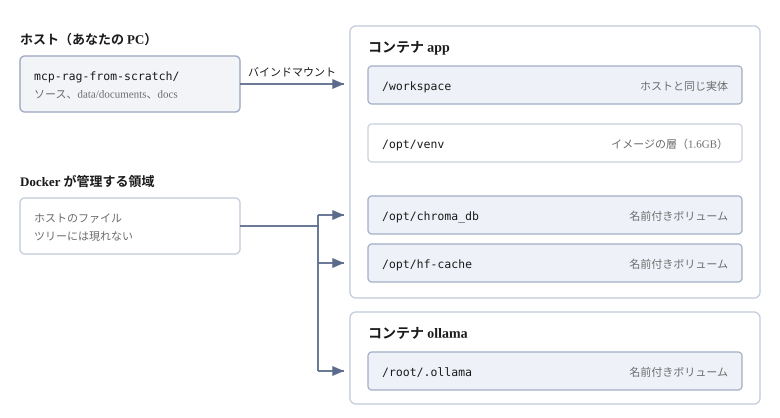

# 動く環境を用意する


このプロジェクトを動かす環境を整え、動くことを確かめる。

読むのは `docker-compose.yml` である。
**どのデータがホストと共有され、どれがコンテナの中だけにあるのか**を押さえておく。
ここが分かっていないと、消したつもりのものが残り、残ると思ったものが消える。

## 全体像

動くコンテナは2つである。

| コンテナ | 役割 | どこから来るか |
|---------|------|--------------|
| `app` | このプロジェクトのコードを動かす | `Dockerfile` からビルドする |
| `ollama` | LLM を動かす | 公開イメージをそのまま使う |

その中で、置き場所は3種類に分かれる。



| コンテナ | 場所 | 中身 | ホストから見えるか | いつ消えるか |
|---------|------|------|-----------------|------------|
| `app` | `/workspace` | ソース、`data/documents`、`docs` | **見える。同じファイル** | 消えない |
| `app` | `/opt/venv` | Python と依存パッケージ（1.6GB） | 見えない | イメージを消すと |
| `app` | `/opt/chroma_db` | ChromaDB の実体（520KB） | 見えない | `down -v` で |
| `app` | `/opt/hf-cache` | 埋め込みモデル（471MB） | 見えない | `down -v` で |
| `ollama` | `/root/.ollama` | Ollama のモデル | 見えない | `down -v` で |

**編集するものはホスト側、生成されるものはコンテナの中**、という分け方である。

## `docker-compose.yml` を読む

### ソースはホストと共有する

```yaml
    volumes:
      - .:/workspace
```

2章で見たバインドマウントである。プロジェクトのトップがまるごと `/workspace` に見える。
**保存した瞬間に反映される**ので、コードを直すたびにコンテナを作り直す必要はない。

### 生成物はコンテナの中に置く

```yaml
    volumes:
      - hf-cache:/opt/hf-cache
      - chroma-db:/opt/chroma_db
```

名前付きボリュームで、**ホストのファイルツリーには現れない**。

コンテナの中では見える。

```bash
docker compose exec app ls /opt/chroma_db
```

```
5a7ada9a-78e7-40fc-8366-3a41162e8f19
chroma.sqlite3
```

ホストの同じ名前を引くと、無い。

```bash
ls chroma_db
```

```
ls: cannot access 'chroma_db': No such file or directory
```

**`/workspace` の下に置かない理由**は、所有者にある。
コンテナの中では root で動いているので、`/workspace` に書くと
**ホスト側に root 所有のファイルが残る**。

同じ理由で、Python が生成するキャッシュも止めてある。

```yaml
    environment:
      PYTHONDONTWRITEBYTECODE: "1"
      PYTEST_ADDOPTS: "-p no:cacheprovider"
```

これが無いと `__pycache__` と `.pytest_cache` が root 所有でホストに残る。

### 仮想環境もコンテナの中

```dockerfile
ENV UV_PROJECT_ENVIRONMENT=/opt/venv
```

`.venv` はプロジェクト直下に作られるのが既定だが、それだと困る。
`/workspace` はホストと共有しているので、**ホスト側で作った `.venv` と
コンテナの `.venv` が同じ場所を奪い合う**。入っているバイナリは別物なので、
混ざると動かない。

`/opt/venv` に逃がしてあるので、ホスト側で `uv sync` していても衝突しない。

```bash
docker compose exec app du -sh /opt/venv
```

```
1.6G	/opt/venv
```

ボリュームではなく**イメージの層**に焼かれている。`down -v` では消えず、
イメージを消すと消える。

### 2つのサービス

```yaml
services:
  app:
    build: .
    depends_on:
      - ollama
    environment:
      OLLAMA_HOST: ${OLLAMA_HOST:-http://ollama:11434}

  ollama:
    image: ollama/ollama:latest
```

`app` から `ollama` へは、**サービス名がそのままホスト名**になる。
IP を調べて書く必要はない。

### 繋がっているか確かめる

`app` の中から `ollama` を呼ぶ。

```bash
docker compose exec app curl -s http://ollama:11434/api/version
```

```json
{"version":"0.40.2"}
```

**これが返れば、2つのコンテナは繋がっている。** ここで確かめたいのはそれだけである。
モデルの取得と、実際に LLM を動かすのは [Ollama を用意する](08-ollama-setup.md) で行う。

ホスト側で Ollama を動かしていて、そちらを使いたい場合は `.env` で上書きする。

```bash
OLLAMA_HOST=http://host.docker.internal:11434
```

## 起動から停止まで

Compose の操作そのものは [Docker 入門](02-docker-basics.md#起動から終了まで) で見た。
ここではこのプロジェクトで実際に打つものを並べる。

```bash
docker compose up -d
```

```
 Container mcp-rag-from-scratch-ollama-1  Started
 Container mcp-rag-from-scratch-app-1     Started
```

作業はコンテナの中で行う。

```bash
docker compose exec app bash
```

```
root@3a77c9ea:/workspace#
```

**作業ディレクトリは `/workspace`** で、ホストのプロジェクトがそのまま見えている。
`uv sync` がプロジェクトを editable install しているので、**`PYTHONPATH` は要らない**。

```bash
uv run python steps/01_chromadb.py
uv run python -m server.indexer
uv run python tools/query_chromadb.py
uv run pytest
```

`exit` で抜け、`docker compose down` で止める。

> [!NOTE]
> `Dockerfile` や `pyproject.toml` を変えたときは、イメージを作り直す。
>
> ```bash
> docker compose build app
> docker compose up -d
> ```

### `down -v` は埋め込みモデルも消す

ボリュームごと消えるので、471MB の埋め込みモデルを次回また落とすことになる。
**普段は `down` でよい。**

## 動いていることを確かめる

最後に、全部まとめて動かす。

```bash
docker compose exec app uv run pytest
```

```
17 passed, 1 warning in 37.98s
```

**ここまでで環境は終わりである。** 2つのコンテナが起動し、互いに繋がり、
ソースはホストと共有され、生成物はボリュームに残る。

## 困ったとき

### `no configuration file provided` と言われる

`docker-compose.yml` のあるディレクトリで実行していない。

```bash
cd /path/to/mcp-rag-from-scratch
ls docker-compose.yml
```

### `steps/01_chromadb.py` が見つからないと言われる

コンテナの中の作業ディレクトリは `/workspace` である。
ホスト側のパスをそのまま渡すと見つからない。

```bash
docker compose exec app pwd
docker compose exec app ls steps/
```

### 埋め込みモデルを毎回ダウンロードしている

`down -v` でボリュームを消している。`hf-cache` が残っていれば再利用される。

```bash
docker volume ls --filter name=hf-cache
```

### `.venv` に関するエラーが出る

ホスト側の `.venv` をコンテナが拾っている。
`UV_PROJECT_ENVIRONMENT=/opt/venv` が効いているか確認する。

```bash
docker compose exec app sh -c 'echo $UV_PROJECT_ENVIRONMENT'
```

### コンテナ内のファイルがホストと違う

`/workspace` の下なら同じ実体である。違って見えるなら、
`/opt` の下（ボリューム）を見ている。

```bash
docker compose exec app ls /workspace
docker compose exec app ls /opt/chroma_db
```

### モデルの取得が名前解決で失敗する

コンテナから外に出られていない。まず切り分ける。

```bash
docker compose exec app getent hosts huggingface.co
docker compose exec app ip addr show eth0
```

IP が付いていなければ、DNS ではなくネットワークの問題である。

`docker-compose.yml` で `ollama` のポートを公開していないのは、
ホスト側で Ollama が動いているときに 11434 が衝突するのを避けるためである。

### ビルドが途中で失敗する

キャッシュを捨ててやり直す。

```bash
docker compose build --no-cache app
```

## 次へ

ここから先は**中身の話**になる。この環境の上で何が起きているのか、
部品を1つずつ動かして確かめていく。

最初は [ChromaDB を動かす](04-chromadb.md) である。
**文書を入れて、質問に近いものを取り出す**ところから始める。
