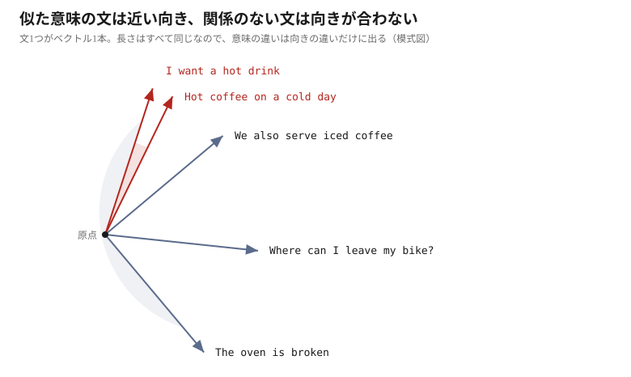

# ChromaDB を動かす


## ChromaDB とは何か

**ベクトルデータベース**である。文字列を渡すと「意味を表す数値の並び」、つまり
**ベクトル**に変換して保存し、質問を渡すと**近い順**に返す。

普通のデータベースなら `LIKE '%warm%'` で引ける。しかしそれでは
「温かい飲み物が欲しい」という質問から `Espresso drinks arrive steaming` は引けない。
**文字が一致しないからである。**



文をベクトルにすると、意味の近さが**向きの近さ**になる。
ChromaDB はこの向きの差を**距離**として返し、小さい順に並べる。

## コードを読む

`steps/01_chromadb.py` のうち、**検索の流れに関わるのは4行だけ**である。
（このほかに、保存されたベクトルを覗く `get()` と件数を数える `count()` を使っている）

```python
client = chromadb.Client()                    # データベースを開く
collection = client.create_collection(...)    # コレクションを作る
collection.add(...)                           # 文書を登録する
collection.query(...)                         # 質問で検索する
```

順に見る。

### 埋め込み関数を用意する

文字列をベクトルに変える部品を作る。

```python
from chromadb.utils.embedding_functions import SentenceTransformerEmbeddingFunction

embedding_function = SentenceTransformerEmbeddingFunction(
    model_name="intfloat/multilingual-e5-small"
)
```

**文字列のリストを受け取り、384次元のベクトルのリストを返す。** それだけの部品である。

### コレクションを作る

```python
client = chromadb.Client()          # メモリ上。プロセスが終われば消える
collection = client.create_collection(
    name="cafe",
    embedding_function=embedding_function,
)
```

**コレクション**が文書の置き場所で、RDB のテーブルに相当する。
ディスクに残したい場合は `chromadb.PersistentClient(path=...)` を使う。

埋め込み関数はここで結び付ける。以降 `add()` も `query()` もこれを内部で呼ぶので、
利用側がベクトルを直接扱う場面はない。

### 文書を登録する — `add()`

渡すものを先に作る。`data/documents` の `.txt` を読んでリストにする。

```python
files = []
for txt_file in sorted(DOCUMENTS_PATH.glob("*.txt")):
    content = txt_file.read_text(encoding="utf-8")
    files.append({"filename": txt_file.name, "content": content})
```

`txt_file.name` がファイル名、`content` がその中身である。
したがって `files` は**ファイル1つにつき辞書1つ**のリストになり、7ファイルなら7件。
1件目はこうなる。

```python
{"filename": "allergens.txt", "content": "The Wandering Kettle - Ingredients..."}
```

これを2本のリストに組み替えて渡す。

```python
collection.add(
    ids=[f["filename"] for f in files],
    documents=[DOCUMENT_PREFIX + f["content"] for f in files],
)
```

つまり `ids` は**ファイル名のリスト**、`documents` は**ファイルの中身のリスト**である。

```python
ids       = ["allergens.txt", "faq.txt", "hours_access.txt", ...]
documents = ["passage: The Wandering Kettle - Ingredients...",
             "passage: The Wandering Kettle - Questions...", ...]
```

どちらも7件で、並び順は同じ。`ids[0]` と `documents[0]` が同じファイルを指す。

`ids` は一意でありさえすればよい。ここではファイル名をそのまま使っている。
`documents` に渡した文字列は、**そのままベクトルになる**。

> [!NOTE]
> **`DOCUMENT_PREFIX` の正体**
>
> ```python
> DOCUMENT_PREFIX = "passage: "
> QUERY_PREFIX = "query: "
> ```
>
> E5 系のモデルは、保存する文書と検索クエリに別々の目印を付けて学習されている。
> 付け忘れても動くが精度が落ちる。モデルごとに決まった作法である。

### 質問で検索する — `query()`

```python
results = collection.query(
    query_texts=["query: What time do you close on Friday?"],
    n_results=3,
)
```

質問も同じ埋め込み関数でベクトルになる。`n_results=3` なので3件が返る。

```python
>>> results["ids"]
[['hours_access.txt', 'staff_handbook.txt', 'menu_food.txt']]

>>> results["distances"]
[[0.1989266276359558, 0.20826709270477295, 0.21306967735290527]]
```

`ids` に並んでいるのは、`add()` のときに渡した **ファイル名**である。
`distances` はそれぞれの**距離**で、**小さいほど質問に近い**。
並びは距離の小さい順なので、先頭の `hours_access.txt` が1位、
3件目の `menu_food.txt` が3位である。

**そして、どちらもリストが二重になっている。** 内側の3件が検索結果で、
外側は質問ごとである。`query_texts` はリストなので、質問を2つ投げれば外側も2件になる。

```python
>>> r = collection.query(query_texts=["query: What time do you close on Friday?",
...                                    "query: Do you have oat milk?"], n_results=2)
>>> r["ids"]
[['hours_access.txt', 'staff_handbook.txt'], ['allergens.txt', 'menu_drinks.txt']]
```

外側は質問が1つでもリストになり、内側は `n_results=1` でもリストになる。
**要素が1つでも形は変わらない**ので、添字を省くことはできない。

つまり**外側の添字で質問を選び、内側の添字で順位を選ぶ**。
`n_results=3` で3件返っているので、1位を取り出すには2段たどることになる。

```python
results["ids"][0]             # 1つ目の質問の結果。3件入っている
                              # -> ['hours_access.txt', 'staff_handbook.txt', 'menu_food.txt']
results["ids"][0][0]          # そのうちの1位 -> 'hours_access.txt'
results["documents"][0][0]    # 1位の本文
results["distances"][0][0]    # 1位の距離 -> 0.1989266276359558
```

---

## 動かして確かめる

実行は Docker のコンテナ内で行う。**プロジェクトのトップ**でコンテナを起動する。

```bash
docker compose up -d
```

起動したら、コンテナの中でスクリプトを実行する。

```bash
docker compose exec app uv run python steps/01_chromadb.py
```

何度も試すなら、コンテナに入ってしまう方が早い。
中は普通の Ubuntu で、作業ディレクトリは `/workspace` になっている。

```bash
docker compose exec app bash
uv run python steps/01_chromadb.py
```

初回は埋め込みモデル（約470MB）のダウンロードが走るため時間がかかる。
2回目以降はキャッシュから読まれる。

**事前にデータベースを作る手順はない。** ChromaDB はメモリ上に作られ、
実行が終われば消える。何度でもやり直せる。

### 対話で試す

質問を変えながら試すなら、Python を対話モードで起動する。

```bash
docker compose exec app bash
uv run python
```

次の7行で、スクリプトと同じ状態になる。

```python
import chromadb
from pathlib import Path
from chromadb.utils.embedding_functions import SentenceTransformerEmbeddingFunction

ef = SentenceTransformerEmbeddingFunction(model_name="intfloat/multilingual-e5-small")
collection = chromadb.Client().create_collection("demo", embedding_function=ef)
for p in sorted(Path("data/documents").glob("*.txt")):
    collection.add(ids=[p.name], documents=["passage: " + p.read_text()])
```

あとは `query()` を直接呼べる。上で見た `>>>` の出力は、ここで再現できる。

```python
>>> r = collection.query(query_texts=["query: Do you have oat milk?"], n_results=2)
>>> r["ids"]
[['allergens.txt', 'menu_drinks.txt']]
```

`query:` の後ろを書き換えれば、どんな質問でも試せる。

終わったらコンテナを止める。

```bash
docker compose down
```

**埋め込みモデルのキャッシュはボリュームに残る**ので、次回は再ダウンロードされない。
消したい場合は `docker compose down -v` を使う。

> [!NOTE]
> Docker の導入は [必要な環境と Docker の導入](01-setup.md)、
> ビルドや日常の操作は [動く環境を用意する](03-environment.md) にある。

資料は `data/documents/` に置いた架空のカフェ **The Wandering Kettle** の7ファイルである。
以下は出力の抜粋である。

### 単語が一致しなくても引ける

```
  Question: I want something warm to drink because it is freezing outside
    distance 0.165  menu_drinks.txt
    "warm" appears in that file: False
    "freezing" appears in that file: False
    "outside" appears in that file: False
```

日本語にすると次のとおり。

```
  質問: 外が凍えるほど寒いので、何か温かい飲み物が欲しい
    距離 0.165  menu_drinks.txt
    このファイルに "warm" は出てくるか: いいえ
    このファイルに "freezing" は出てくるか: いいえ
    このファイルに "outside" は出てくるか: いいえ
```

**キーワード検索では決して返ってこない。** 書かれているのは別の表現である。

```
Espresso drinks arrive steaming in a heavy ceramic cup that keeps
its temperature for a good twenty minutes.
```

`steaming`（湯気を立てて）が「温かい」と、空間の中で近い位置にある。

### 距離の読み方

距離は**コサイン距離**で、向きが揃っているほど 0 に近づく。
絶対値には意味がなく、**同じ検索の中での順位**だけを見る。

## ここまでで分かったこと

- ChromaDB に渡すのは文字列。ベクトル化はライブラリの側で起きる
- 長さに関わらず、1つの文書は384次元のベクトル1本になる
- ベクトル検索は単語の一致を見ていない。だから言い換えでも引ける
- 距離はコサイン距離。絶対値ではなく順位で読む

次章では、このデータベースを**ディスクに作り置き**し、
あとから呼び出せる `search()` を用意する。
