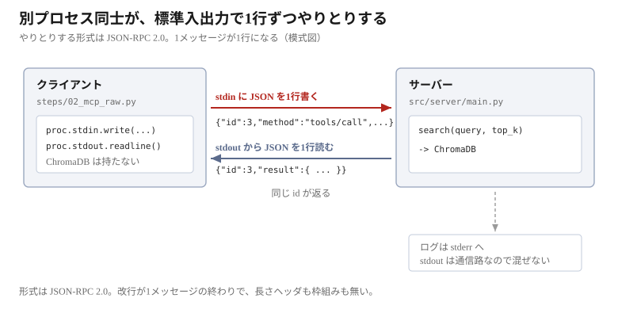
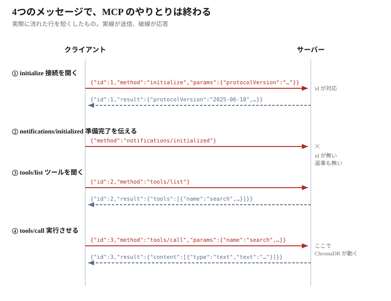

# MCP を生の JSON-RPC で話す


ここからが本題である。前章までに用意した `search()` を、
**別のプロセスから呼ぶ**。そのための取り決めが MCP である。

## やりとりの中身は JSON

この章では JSON を読み書きする。必要なのは2つの記号だけである。

| 記号 | 意味 |
|------|------|
| `{ }` | **名前と値の組**。名前は必ず文字列で、`"名前": 値` と書く |
| `[ ]` | **並び**。値をカンマで区切って入れる |

値には文字列、数値、真偽値のほか、`{ }` や `[ ]` をそのまま入れられる。
この入れ子が JSON の全部である。

```json
{
  "name": "search",
  "top_k": 3,
  "results": ["hours_access.txt", "staff_handbook.txt"],
  "options": {"prefix": "query: "}
}
```

`results` の値が `[ ]` の並びで、`options` の値が `{ }` になっている。
**値の位置には、また `{ }` も `[ ]` も置ける。**

改行と字下げは読みやすさのためのもので、意味には関係しない。
実際に送るときは1行で書く。

```json
{"name": "search", "top_k": 3, "results": ["hours_access.txt", "staff_handbook.txt"], "options": {"prefix": "query: "}}
```

**この2つは同じものである。**

## 入れ物は JSON-RPC 2.0

JSON をどう並べてもよいわけではない。**JSON-RPC 2.0** という既存の取り決めに
乗っている。「別のプロセスにあるものを名前で呼ぶ」ためのもので、
決めているのは**フィールドの名前**だけである。

呼ぶ側。

| 名前 | 中身 |
|------|------|
| `jsonrpc` | 常に `"2.0"` |
| `id` | 要求の番号。返事と突き合わせるのに使う |
| `method` | 呼びたいものの名前 |
| `params` | 引数。無ければ省く |

返す側。

| 名前 | 中身 |
|------|------|
| `jsonrpc` | 常に `"2.0"` |
| `id` | どの要求への返事かを示す |
| `result` | 結果 |

```json
{"jsonrpc": "2.0", "id": 2, "method": "tools/list"}
{"jsonrpc":"2.0","id":2,"result":{"tools":[ ... ]}}
```

上が要求、下が返事である。`id` が同じなので対応が分かる。

**JSON-RPC が決めるのは、この入れ物だけである。**
`method` にどんな名前が使えるか——`initialize`、`tools/list`、`tools/call`——
を決めているのが MCP である。

## MCP とは何か

**Model Context Protocol** の略である。
名前のとおり、モデル（LLM）に外部の文脈を渡すための取り決めで、
**アプリと外部のツールをつなぐ**ために使う。

ツールを提供する側を**サーバー**、使う側を**クライアント**と呼ぶ。



この教材でのサーバーは `src/server/main.py` で、前章の `search()` を持っている。
クライアントは `steps/02_mcp_raw.py` である。

**なぜ分けるのか。** 同じプロセスなら `search()` を直接呼べばよい。
分けることで、**別の言語で書かれたツールでも、別のマシンにあるツールでも同じ手順で呼べる**。
MCP が決めているのは、その手順である。

## 通信路は標準入出力

MCP の転送方式はいくつかあるが、この教材は **stdio**（標準入出力）を使う。

- クライアントがサーバーを**子プロセス**として起動する
- サーバーの**標準入力**に書く = 送信
- サーバーの**標準出力**から読む = 受信

長さヘッダも、枠組みも、独自のハンドシェイクもない。
**改行が1メッセージの終わり**で、中身はただの JSON-RPC 2.0 である。

```python
proc.stdin.write(line + "\n")   # 改行がメッセージの終わり
proc.stdin.flush()              # これが無いとサーバーは待ち続ける
line = proc.stdout.readline()   # 受信も1行読むだけ
proc.stdin.close()              # 閉じる = 終了の合図
```

送信と受信は実質3行しかない。終了メッセージも無く、
**標準入力を閉じること自体が終わりの合図**である。
サーバーは EOF を受け取り、自分で終了する。

> [!NOTE]
> **サーバーのログが stdout に出てはいけない**
>
> 標準出力は通信路である。`print()` を1回混ぜるだけで JSON が壊れる。
> だからサーバー側のログは**必ず stderr に出す**。

## 4つのメッセージで検索を1回呼ぶ

`steps/02_mcp_raw.py` を動かす。SDK は使わず、**JSON を1行書いては1行読む**
というやりとりを手で組み立てたクライアントである。

```bash
docker compose exec app uv run python steps/02_mcp_raw.py
```

やることは `search()` を1回呼ぶだけだが、そこに至るまでに4つのメッセージが流れる。



**`id` を持つ3つには応答が返り、`id` の無い②には返らない。**
順に見る。以下はすべて実際に流れた行である。

### 1. initialize — 接続を開く

`method` に `initialize` を入れて送る。**接続して最初に送るのはこれと決まっている。**
自分が話せるバージョン（`protocolVersion`）と、自分の名前（`clientInfo`）を伝える。

```json
{
  "jsonrpc": "2.0",
  "id": 1,
  "method": "initialize",
  "params": {
    "protocolVersion": "2025-06-18",
    "capabilities": {},
    "clientInfo": {"name": "raw-client", "version": "0.1.0"}
  }
}
```

返ってくる。

```json
{
  "jsonrpc": "2.0",
  "id": 1,
  "result": {
    "capabilities": {"tools": { ... }, ... },
    "protocolVersion": "2025-06-18",
    "serverInfo": {"name": "rag-search-server", "version": ""}
  }
}
```

**`id` が対応している。** 送った `id: 1` に対し、`id: 1` で返っている。
複数のリクエストを同時に投げても、`id` で返事を紐づけられる。

`capabilities` はサーバーができることの申告で、**`tools` を持っていると言っている**。
これがあるから、次に `tools/list` を聞ける。
（`prompts` や `resources` も並ぶが、この教材では使わないので省いた）

`protocolVersion` は**返ってきた方が合意したバージョン**である。
送ったバージョンをサーバーが知らない場合、エラーにはならず、
サーバーが話せるバージョンが返る。クライアントは、それを話せるなら合わせ、
話せなければ接続をやめる。

> [!NOTE]
> **先に送らないと断られる**
>
> `initialize` を飛ばして `tools/list` を送ると、`result` ではなく `error` が返る。
>
> ```json
> {"jsonrpc":"2.0","id":1,"error":{"code":-32602,"message":"Invalid request parameters","data":""}}
> ```
>
> 失敗したときは `result` の代わりに `error` が入る、というのも JSON-RPC の決まりである。

### 2. notifications/initialized — 返事の無いメッセージ

`initialize` の返事を受け取ったら、**準備ができたとサーバーに伝える**。
これで接続の手続きが終わり、以降はツールを呼べる。

```json
{
  "jsonrpc": "2.0",
  "method": "notifications/initialized"
}
```

伝えるだけで、サーバーに聞きたいことは無い。だから `params` も無ければ、
**`id` も無い**。これが**通知**である。リクエストではないので、返事は返らない。

ここで受信しようとすると、**次の応答が来るまでブロックする**。
`id` の有無が「返事を待つかどうか」を決める、というのが JSON-RPC の作りである。

### 3. tools/list — ツールを聞く

```json
{
  "jsonrpc": "2.0",
  "id": 2,
  "method": "tools/list"
}
```

返ってくるのはツールの定義である。実際には1行で1996文字ある。

```json
{
  "jsonrpc": "2.0",
  "id": 2,
  "result": {
    "tools": [
      {
        "description": "\nSearch the documents of a cafe called The Wandering Kettle.\n\nUse this to answer questions about ...",
        "inputSchema": {
          "properties": {
            "query": {"title": "Query", "type": "string"},
            "top_k": {"default": 5, "title": "Top K", "type": "integer"}
          },
          "required": ["query"],
          "type": "object",
          "title": "searchArguments"
        },
        "name": "search",
        "outputSchema": { ... }
      },
      {
        "description": "\nList the names of the document files that can be searched.\n\n...",
        "inputSchema": {
          "properties": {},
          "type": "object",
          "title": "list_documentsArguments"
        },
        "name": "list_documents",
        "outputSchema": { ... }
      },
      {
        "description": "\nReturn one document file in full, by its exact file name.\n\n...",
        "inputSchema": {
          "properties": {
            "name": {"title": "Name", "type": "string"}
          },
          "required": ["name"],
          "type": "object",
          "title": "get_documentArguments"
        },
        "name": "get_document",
        "outputSchema": { ... }
      }
    ]
  }
}
```

（`description` の本文と `outputSchema` の中身は長いので省いた）

**`tools` は配列である。** このサーバーは3つ持っているので、3件並ぶ。
1件につき `name` / `description` / `inputSchema` が入る。

| ツール | 何をするか | 引数 |
|-------|-----------|------|
| `search` | 意味の近い文書を探す | `query`、`top_k`（既定 5） |
| `list_documents` | ファイル名を一覧する | 無し |
| `get_document` | ファイル1つを丸ごと返す | `name` |

**`inputSchema` はツールごとに違う。** `list_documents` は引数が無いので
`properties` が空で、`required` も無い。`get_document` は `name` が必須である。

クライアントは、この一覧を見て**どんなツールがあるかを知る**。
事前に知っている必要はなく、`tools/list` で聞けばよい。

`inputSchema` は **JSON Schema** である。引数の名前、型、既定値、必須かどうかが書かれている。
`tools/call` で送る引数は、これに従う。

`description` は自由なテキストで、**これを読むのは LLM である**。
「どんなときにこのツールを使うか」を伝えるためにある。

### 4. tools/call — 実行させる

```json
{
  "jsonrpc": "2.0",
  "id": 3,
  "method": "tools/call",
  "params": {
    "name": "search",
    "arguments": {"query": "can I bring a dog", "top_k": 1}
  }
}
```

`params` に、ツール名と引数を入れる。引数は `tools/list` で返ってきた
`inputSchema` に従う。

返ってくる。実際には1行で3609文字ある。

```json
{
  "jsonrpc": "2.0",
  "id": 3,
  "result": {
    "content": [
      {
        "text": "[1] source: faq.txt (distance: 0.21)\npassage: \nThe Wandering Kettle - ...",
        "type": "text"
      }
    ],
    "isError": false,
    "structuredContent": { ... }
  }
}
```

（`text` の本文と `structuredContent` の中身は長いので省いた）

**結果は `content` という配列**に入る。要素は `type` で区別され、ここでは `text` である。
`text` の中身は 1689 文字で、前章の `search()` が返した文字列そのままである。

`isError` で成功か失敗かを伝える。ツールの中で例外が起きても
JSON-RPC のエラーにはならず、**この値が `true` になって返る**。

ここで初めて、**プロセスの向こう側で ChromaDB が動いた**。
クライアントは ChromaDB を import していないし、埋め込みモデルも持っていない。

## ここまでで分かったこと

- MCP の stdio 転送は、**改行区切りの JSON を書いて読む**だけ。閉じれば終わる
- `id` があればリクエスト、無ければ通知。返事を待つかどうかが決まる
- `tools/list` が返す `inputSchema` は JSON Schema。引数の形はここで決まる
- `tools/call` の結果は `content` 配列で返る
- 合意したバージョンは、サーバーの返事に入っている
- **ここまでに LLM は一度も登場していない。** MCP の通信に LLM は関係しない

**SDK は、この4つのやりとりを隠しているだけである。**
次の Step 3 で同じことを公式 SDK で書き、何が省けるのかを見る。
