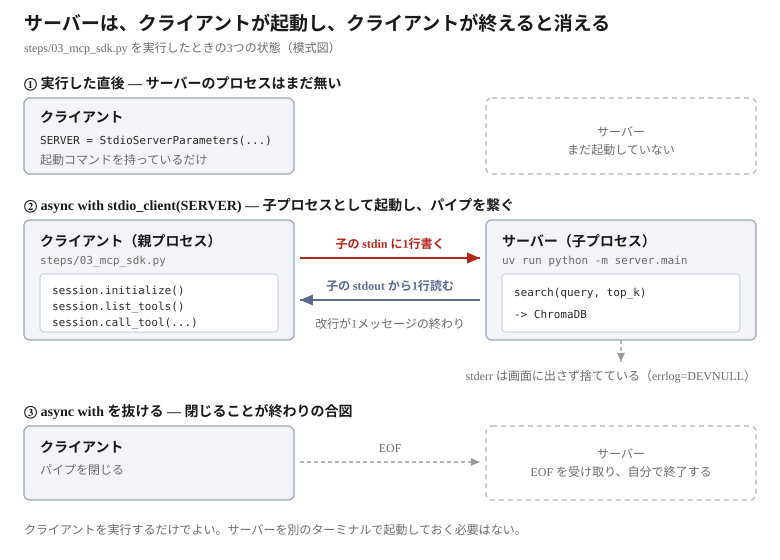

# MCP を SDK で書く


前章では、4つのやりとりを JSON-RPC のまま追った。同じことを公式 SDK で書く。


## サーバーを書く

`src/server/main.py` である。ツール1つにつき、必要なのはこれだけである
（実際には3つ登録しているが、ここでは `search` だけを抜き出した）。

```python
from mcp.server.mcpserver import MCPServer

mcp = MCPServer("rag-search-server")

@mcp.tool()
def search(query: str, top_k: int = 5) -> str:
    """
    Search the documents of a cafe called The Wandering Kettle.

    Use this to answer questions about the menu, prices, opening hours,
    location, wifi and power sockets, allergies and dietary options, the
    staff handbook, and the history of the shop.
    """
    ...

if __name__ == "__main__":
    mcp.run()
```

**`@mcp.tool()` を付けた関数が、そのままツールになる。**

ここで言う「ツールになる」とは、**`tools/list` への応答が関数から自動で作られる**ということである。
前章では、この応答が返ってきた。

```json
{
  "name": "search",
  "description": "Search the documents of a cafe called The Wandering Kettle. ...",
  "inputSchema": {
    "type": "object",
    "properties": {
      "query": {"type": "string",  "title": "Query"},
      "top_k": {"type": "integer", "title": "Top K", "default": 5}
    },
    "required": ["query"]
  }
}
```

この JSON は、どこにも書かれていない。上の `search` から組み立てられている。

| 応答の中身 | 関数のどこから来たか |
|-----------|-------------------|
| `"name": "search"` | 関数名 `def search(...)` |
| `"description"` | docstring |
| `properties` の `query` / `top_k` | 引数の名前 |
| `"type": "string"` / `"integer"` | 型ヒント `query: str` / `top_k: int` |
| `"title": "Query"` | 引数名から自動で付く（表示用） |
| `"default": 5` | 既定値 `top_k: int = 5` |
| `"required": ["query"]` | 既定値の**無い**引数 |

`top_k` は既定値があるので `required` に入らない。
**型ヒントを書かなければ `type` が決まらず、ツールは壊れる。**

> [!TIP]
> **デコレータ `@mcp.tool()` とは — Python の書き方**
>
> `@` で始まる行はデコレータといい、直後の関数に付ける印である。
> `search` 自体は普通の Python 関数のままで、書き方は何も変わらない。
> その上に1行足すと「この関数を MCP のツールとして公開する」という意味になる。
> Web フレームワークで `@app.route("/search")` と書くと関数が URL になるのと同じ発想である。
>
> 関数の書き方がそのまま仕様になるので、ツールを書くときには決まりがある。
>
> - **引数に型ヒントを付ける。** 省くと `inputSchema` が作れない
> - **docstring を書く。** LLM が読む説明文になる（次の NOTE）
> - **関数名がそのままツール名になる。** `f` や `do_it` では LLM が選べない
> - **`return` した値がそのまま LLM に届く。** `tools/call` の応答の `content` に入る。
>   このプロジェクトでは整形済みのテキスト1本を返している
> - **stdout に `print` しない。** そこは JSON-RPC の通り道。ログは stderr へ
>
> 決まりを守る限り、公開するツールを増やす作業は「関数を書いて `@mcp.tool()` を付ける」だけになる。

`mcp.run()` が stdio で待ち受ける。前章で見た「改行区切りの JSON を読み書きする」
処理は、この中にある。

> [!NOTE]
> **docstring は LLM への指示である**
>
> 人間向けのコメントではない。この文章が `description` として LLM に渡り、
> **どんなときにこのツールを呼ぶか**の判断材料になる。
> 「何をするか」だけでなく「どんな質問に使えるか」を書く。

## クライアントを書く

`steps/03_mcp_sdk.py` である。

読む前に1つ。**stdio では、クライアントがサーバーを子プロセスとして起動する**
（[前章](06-mcp-protocol.md#通信路は標準入出力)）。別のターミナルでサーバーを
先に立ち上げておく必要はない。**クライアントを実行すれば、その中でサーバーが起動する。**

それをやっているのが、次のコードである。

```python
from mcp import ClientSession, StdioServerParameters
from mcp.client.stdio import stdio_client

# ① サーバーの起動方法を書く。ここではまだ起動しない
SERVER = StdioServerParameters(
    command="uv",
    args=["run", "python", "-m", "server.main"],
)

# ② 起動して、会話する
async with stdio_client(SERVER) as (read, write):
    async with ClientSession(read, write) as session:
        info = await session.initialize()
        tools = (await session.list_tools()).tools
        result = await session.call_tool("search", {"query": "can I bring a dog", "top_k": 1})
```

**①の `StdioServerParameters` は、起動コマンドを書き留めただけ**である。
`command` と `args` を繋げると `uv run python -m server.main` になる。
サーバーを手で起動するときに打つコマンドと同じものである。

**②の `stdio_client` が、そのコマンドを実際に子プロセスとして起動する。**
前章で `subprocess.Popen` を書いた部分にあたる。
起動した子プロセスの標準入出力が `read` / `write` で、`ClientSession` がそこに JSON-RPC を流す。

残る3行が会話である。

```python
info = await session.initialize()
tools = (await session.list_tools()).tools
result = await session.call_tool("search", {"query": "can I bring a dog", "top_k": 1})
```

- `initialize()` で接続を開く。**これを呼ばないと、他は呼べない**（前章）
- `list_tools()` が返すのは一覧そのものではなく、それを**包んだオブジェクト**である。
  ツールの配列は `.tools` で取り出す
- `call_tool()` には**ツール名**と**引数の辞書**を渡す。引数は `inputSchema` に従う。
  前章で `params` の `name` と `arguments` に入れたものと同じである

どれも `await` が付く。**応答が返るまで待つ**からである。

> [!TIP]
> **`async` と `await` — Python の書き方**
>
> MCP SDK のクライアント API は、すべて**非同期**である。
> パイプに1行書いて、返事の1行が届くまで待つ、という処理だからである。
>
> 使うために覚えることは3つしかない。
>
> - **`await` を付けて呼ぶ。** 付け忘れると、結果ではなく「実行の予約」が返り、
>   通信は起きない
> - **`await` は `async def` の中でしか書けない。** だからこの処理全体を
>   `async def main()` に入れている
> - **`async def` の関数は、呼んだだけでは動かない。** `asyncio.run(main())` で起動する
>
> ```python
> async def main():
>     ...
>     info = await session.initialize()
>
> asyncio.run(main())
> ```
>
> `async with` も `with` と同じで、ブロックを抜けるときに後始末をする。
> 違いは、その後始末にも待ち時間があることだけである。
>
> 「待っている間に他の処理を進められる」のが非同期の利点だが、
> **この教材では1つずつ順に待つだけ**なので、その恩恵は使っていない。
> SDK がそう書かれているので合わせている、と考えてよい。

`async with` を抜けると接続が閉じ、サーバーも終了する。
前章の `proc.stdin.close()` は書かなくてよい。

**①と②が実行時にどうなるかを、順に並べるとこうなる。**
図の番号は、コードのコメントの番号と対応している。



①の時点では、サーバーのプロセスはまだ存在しない。
②で初めて起動し、③で `async with` を抜けると消える。

実際のコードでは、2つ引数が増えている。

```python
SERVER = StdioServerParameters(..., env=dict(os.environ))
async with stdio_client(SERVER, errlog=subprocess.DEVNULL) as (read, write):
```

| 引数 | なぜ要るか |
|------|-----------|
| `env` | 子プロセスに環境変数を渡す。`RAG_CHROMA_PATH` が無いとデータベースを見つけられない |
| `errlog` | サーバーの stderr の行き先。既定では画面に出るので、捨てて読みやすくする |

動かす。

```bash
docker compose exec app uv run python steps/03_mcp_sdk.py
```

```
[1] session.initialize()
    server   : rag-search-server
    version  : 2025-11-25

[2] session.list_tools()
    name     : search
    arguments: ['query', 'top_k']
    required : ['query']
    name     : list_documents
    arguments: []
    required : []
    name     : get_document
    arguments: ['name']
    required : ['name']

[3] session.call_tool()
    is_error : False
    content  : 1 block(s), type text
    text     : 1689 characters
    first    : [1] source: faq.txt (distance: 0.21)
```

## 4つのやりとりが、3つの呼び出しになる

| 前章のメッセージ | SDK での呼び出し |
|----------------|----------------|
| `initialize` | `session.initialize()` |
| `notifications/initialized` | 同上に**含まれる** |
| `tools/list` | `session.list_tools()` |
| `tools/call` | `session.call_tool(name, arguments)` |

**②が消えている。** `initialize()` は、リクエストを送って応答を受け取った後、
続けて通知も送る。返事の無いメッセージを忘れる心配がなくなる。

## SDK が代行していること

| 前章で自分で書いた | SDK では |
|-----------------|---------|
| `subprocess.Popen` でサーバーを起動 | `stdio_client` が起動する |
| `json.dumps` / `json.loads` | 不要 |
| `id` を1, 2, 3 と振る | 自動で振り、応答と突き合わせる |
| 通知を送り、**受信しない**よう気をつける | `initialize()` に含まれる |
| `proc.stdin.close()` で終了 | `async with` を抜ければ閉じる |

行数にすると **229行 → 87行**になる。

## 戻り値は辞書ではなく型付きオブジェクト

生の JSON では、すべてが辞書だった。

```python
result["result"]["content"][0]["text"]     # 前章
```

SDK は型の付いたオブジェクトを返す。

```python
result.content[0].text                     # この章
```

このプロジェクトで使う属性は、次のとおりである。
**左が前章で見た JSON のキー、右がそれを読む属性**である。

**`session.initialize()` → `InitializeResult`**

| 前章の JSON | 属性 | 中身 |
|------------|------|------|
| `serverInfo.name` | `.server_info.name` | サーバー名 |
| `protocolVersion` | `.protocol_version` | 合意したバージョン |
| `capabilities` | `.capabilities` | サーバーができること |

**`session.list_tools()` → `ListToolsResult`**

| 前章の JSON | 属性 | 中身 |
|------------|------|------|
| `result.tools` | `.tools` | `Tool` のリスト |
| `name` | `.tools[0].name` | ツール名 |
| `description` | `.tools[0].description` | 説明 |
| **`inputSchema`** | `.tools[0].input_schema` | 引数の定義 |

**`session.call_tool(name, arguments)` → `CallToolResult`**

| 前章の JSON | 属性 | 中身 |
|------------|------|------|
| `content` | `.content` | `TextContent` のリスト |
| `type` | `.content[0].type` | 種類（`"text"`） |
| `text` | `.content[0].text` | 本文 |
| `isError` | `.is_error` | ツールが失敗したか |

キーの打ち間違いが実行前に分かる、という利点がある。

> [!NOTE]
> **Python の属性名と、実際に流れる JSON のキーは別物**
>
> `Tool` の属性は `input_schema` だが、JSON のキーは `inputSchema` である。
> SDK v2 で属性名が Python らしく変わっただけで、**仕様が決めているのは JSON の方**。

## ここまでで分かったこと

- `@mcp.tool()` を付けた関数が、そのままツールになる
- `description` は docstring、`inputSchema` は**型ヒント**から作られる
- SDK は、プロセス起動・JSON 変換・`id` 管理・通知・終了処理を代行する
- 4つのメッセージが3つの呼び出しになる。通知は `initialize()` に含まれる
- 戻り値は辞書ではなく型付きオブジェクト

次の Step 4 で **LLM を載せる**。ツール定義を LLM に渡し、
どのツールを呼ぶかを LLM に決めさせる。そこで RAG が完成する。
