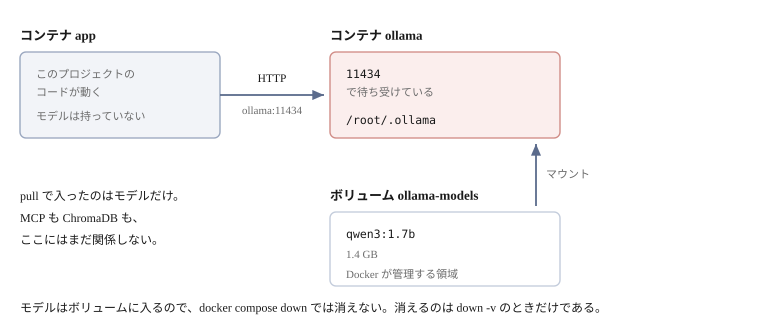
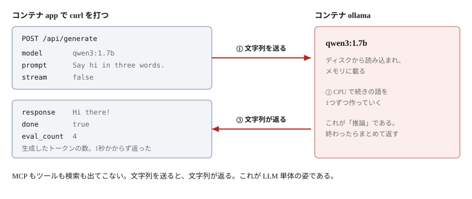

# Ollama を用意する


Ollama はすでに `docker-compose.yml` に入っている。**インストールは要らない。**
やることは**モデルを1つ取ってくる**だけである。

## Ollama とは何か

**LLM を自分のマシンで動かすためのソフトウェア**である。
モデルを取ってきて、HTTP で問い合わせられるようにしてくれる。

**API キーも、外部への通信も要らない。** 入力した文章がどこかに送られることはない。
この教材が Ollama を使うのは、すべてローカルで完結させたいからである。

Ollama 自体は LLM ではない。**モデルを動かす器**である。
使いたいモデルは、名前で指定して自分で取ってくる。

## サービスとして動いている

```yaml
services:
  ollama:
    image: ollama/ollama:latest
    volumes:
      - ollama-models:/root/.ollama
```

`docker compose up -d` を実行した時点で、`app` と一緒に起動している。

```bash
docker compose ps
```

```
SERVICE   STATUS
app       Up 3 minutes
ollama    Up 3 minutes
```

`app` から届くか確かめる。

```bash
docker compose exec app curl -s http://ollama:11434/api/version
```

```json
{"version":"0.40.2"}
```

`ollama` という名前で引けるのは、**サービス名がそのままホスト名になる**からである。

## モデルを取ってくる

まだ何も入っていない。

```bash
docker compose exec ollama ollama list
```

```
NAME    ID    SIZE    MODIFIED
```

取得する。

```bash
docker compose exec ollama ollama pull qwen3:1.7b
```

1.4GB あるが、26秒ほどで終わる（回線による）。

```bash
docker compose exec ollama ollama list
```

```
NAME          ID              SIZE      MODIFIED
qwen3:1.7b    8f68893c685c    1.4 GB    24 seconds ago
```

`app` から見えることも確かめておく。

```bash
docker compose exec app curl -s http://ollama:11434/api/tags
```

```json
{"models":[{"name":"qwen3:1.7b", ...}]}
```

ここまでで、状態はこうなっている。



**入ったのはモデルのファイルだけである。** `ollama` コンテナはもともと動いていて、
`pull` でその置き場所（ボリューム）に 1.4 GB が加わった。

### なぜ `qwen3:1.7b` なのか

`1.7b` はパラメータ数が17億という意味で、**小さい部類**に入る。
CPU でも動き、ダウンロードも1GB強で済む。
大きいモデルほど賢いが、その分メモリと時間を食う。
**この教材は仕組みを見るのが目的なので、小さいもので十分である。**

ただし、小さければ何でもよいわけではない。この教材では
LLM に「どのツールを呼ぶか」を決めさせるので、
**ツール呼び出し（tool calling）に対応したモデル**が要る。
対応していないモデルに渡すと、ツールの定義を無視して適当に答えてしまう。

`qwen3` は対応している。差し替える場合は、対応の有無を確認する。

## モデルはボリュームに残る

```bash
docker compose exec ollama du -sh /root/.ollama
```

```
1.3G	/root/.ollama
```

**Ollama 自身はボリュームを知らない。** `/root/.ollama` という自分のデータ置き場に
書いているだけである。そこへ `docker-compose.yml` が名前付きボリュームを被せている。

```yaml
  ollama:
    volumes:
      - ollama-models:/root/.ollama
```

Ollama から見れば普通のディレクトリだが、実体はコンテナの書き込み層ではなく
ボリュームの中にある（[2章](02-docker-basics.md)）。だから**`docker compose down`
でコンテナを消しても、モデルは残る。** 取り直しは要らない。

```bash
docker compose down -v    # これを使うと消える
```

## 動かしてみる

HTTP で直接叩く。MCP もクライアントも通さない。

```bash
docker compose exec app curl -s http://ollama:11434/api/generate -d '{
  "model": "qwen3:1.7b",
  "prompt": "Say hi in three words.",
  "stream": false,
  "think": false
}'
```

```json
{"response":"Hi there!", "done":true, "eval_count":4, ...}
```

1秒かからずに返る。**これで準備は終わりである。**



**やりとりは1往復しかない。** `prompt` に文字列を入れて送ると、
`response` に文字列が返る。その間にモデルが読み込まれ、続きの語が計算されている。

`eval_count` は生成した**トークン**（語より細かい単位）の数である。
ここでは4つしか作っていないので一瞬で返るが、長い文章を書かせれば、
その数に比例して時間がかかる。

> [!NOTE]
> **`think` を false にしている**
>
> 省くと `qwen3` は考えた過程も返す。この質問を何度か投げた実測では、
> `think: false` なら 0.7 秒・7トークンで安定するのに対し、
> 省くと 55 秒から 313 秒（314〜1470 トークン）とばらついた。
> ここでは応答の形が見たいだけなので、切っている。

## Ollama の API は JSON-RPC ではない

6章・7章で見た MCP とは、**まったく別の取り決め**である。同じ JSON を使うので
混同しやすいが、共通しているのはそこだけである。

| | MCP サーバー | Ollama |
|---|---|---|
| 転送 | 標準入出力 | HTTP |
| 形式 | JSON-RPC 2.0 | ただの JSON（POST の本文） |
| 何を呼ぶかの指定 | `method`（メッセージの中） | **URL のパス** |
| 起動 | クライアントが子プロセスとして起動する | 先に動いているものに繋ぐ |
| 接続の開始 | `initialize` が要る | 無い。いきなり POST する |
| `id` | 要る。応答と突き合わせる | 無い。HTTP の応答がその返事 |
| 状態 | セッションが続く | 毎回それきり |

**Ollama 側には、取り決めらしい取り決めが無い。** URL に JSON を POST すれば、
JSON が返る。それだけである。6章の「4つのやりとり」に相当するものは無い。

### URL が MCP の `method` にあたる

この章で3つの URL を叩いている。

| URL | 何をするか |
|-----|-----------|
| `/api/version` | バージョンを返す |
| `/api/tags` | 取得済みのモデルを一覧する |
| `/api/generate` | プロンプトを渡して、文章を書かせる |

**MCP で `method` に書いていたものが、こちらでは URL になっている。**

```
MCP     {"jsonrpc": "2.0", "id": 2, "method": "tools/list"}
Ollama  POST /api/tags
```

どちらも「何を呼ぶか」の指定で、**置き場所が違うだけ**である。
MCP は1本の接続にすべてのメッセージを流すので、名前を中に書く必要があった。
Ollama は呼ぶたびに別の HTTP リクエストなので、URL で足りる。

どの URL も独立している。`/api/version` を呼んでから `/api/generate` を呼ぶ、
といった順序の決まりも無い。

実際にクライアントが使うのは、もう1つ `/api/chat` である。
会話の形でやりとりし、**ツールの一覧も渡せる**。それを使うのが Step 4 になる。

## 別のモデルを使う

環境変数で変えられる。`.env` に書く。

```bash
OLLAMA_MODEL=qwen3:4b
```

`src/server/config.py` がこれを読む。既定は `qwen3:1.7b` である。

忘れずに取得しておく。

```bash
docker compose exec ollama ollama pull qwen3:4b
```

**ツール呼び出しに対応したモデルを選ぶ**（[上記](#なぜ-qwen317b-なのか)）。

## ホスト側の Ollama を使う

すでにホストで Ollama を動かしているなら、そちらを使ってもよい。
モデルを二重に持たずに済む。

`.env` に書く。

```bash
OLLAMA_HOST=http://host.docker.internal:11434
```

`host.docker.internal` はホスト自身を指す名前である。
Linux では既定で解決できないので、`docker-compose.yml` で足してある。

```yaml
    extra_hosts:
      - "host.docker.internal:host-gateway"
```

解決できるか確かめる。

```bash
docker compose exec app getent hosts host.docker.internal
```

```
172.17.0.1      host.docker.internal
```

> [!WARNING]
> **ホスト側の Ollama は待ち受けアドレスを変える必要がある**
>
> Ollama は既定で `127.0.0.1` だけを待ち受ける。**コンテナからは届かない。**
> ホスト側で `OLLAMA_HOST=0.0.0.0` を設定し、**Ollama を再起動する**。
>
> 同じ `OLLAMA_HOST` という名前が、ここでは2つの意味で出てくる。
>
> | 書く場所 | 値 | 意味 |
> |---------|---|------|
> | このプロジェクトの `.env` | `http://host.docker.internal:11434` | **接続先**の URL |
> | ホスト側の Ollama | `0.0.0.0` | **待ち受ける**アドレス |
>
> `0.0.0.0` にすると、同じネットワークの他のマシンからも届くようになる。

## 困ったとき

### `connection refused` になる

`ollama` サービスが起動していない。

```bash
docker compose ps
docker compose up -d
```

### `model not found` と言われる

取得していない。名前も確認する。

```bash
docker compose exec ollama ollama list
```

### 応答が返ってこない

CPU で動いているので、大きいモデルでは時間がかかる。
まず `qwen3:1.7b` で試す。

> [!NOTE]
> macOS では Apple Silicon の GPU をコンテナに渡せない。
> コンテナ内の Ollama は**CPU 推論**になる。
> 速度が要るなら、ホスト側の Ollama を使う（上記）。

## ここまでで分かったこと

- Ollama は `docker compose up -d` で一緒に起動する。インストールは不要
- やることは `ollama pull` でモデルを1つ取ること
- モデルはボリュームに残り、`down` では消えない
- ホスト側の Ollama も `.env` で使える
- **API は JSON-RPC ではない。** URL に JSON を POST すれば JSON が返るだけで、
  `initialize` も `id` もセッションも無い

Ollama 単体で動くところまで来た。ただしこれは**ただの LLM で、MCP も検索も知らない**。
次章で、これを MCP サーバーとどう組み合わせるのかを見る。
