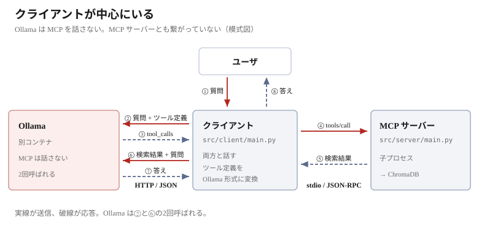
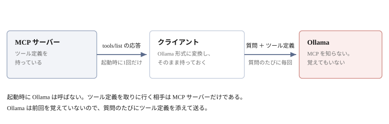
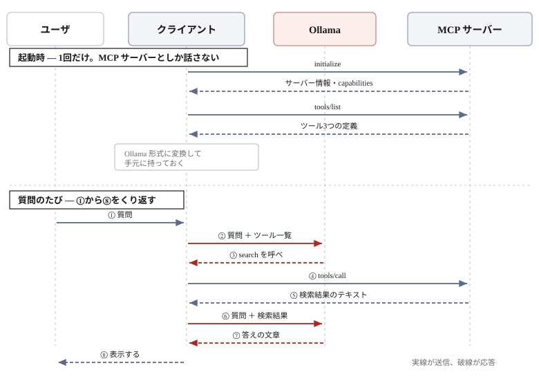

# MCP と Ollama の関係


ツールを別プロセスから呼べるようになり、Ollama も動くようになった。
残るのは**どのツールをどう呼ぶかを LLM に決めさせる**ことである。

この章では、その2つがどう組み合わさるのかを見る。動かすのは次章である。

## 全体の構造

登場するのは3つのプロセスである。



| | 役割 | 話す相手 |
|---|------|---------|
| **クライアント** | 全体を進行する | Ollama と MCP サーバーの両方 |
| **MCP サーバー** | ツールを提供する | クライアントだけ |
| **Ollama** | どのツールを呼ぶか決め、答えを書く | クライアントだけ |

**クライアントが中心にいる。** Ollama と MCP サーバーは直接つながっていない。

## Ollama は MCP を知らない

ここが誤解しやすい。

**Ollama は MCP サーバーの存在を知らないし、MCP という規約も話さない。**
ただの LLM で、クライアントが `http://ollama:11434` に HTTP で問い合わせる相手にすぎない。

ではなぜツールを選べるのか。**毎回クライアントが教えているからである。**



ツール定義の出どころは MCP サーバーである。クライアントは**起動したときに
`tools/list` で一度受け取り**、Ollama が読める形に変換して持っておく。

Ollama に渡るのは、そこから先である。**質問のたびに、持っているツール定義を添えて送る。**
Ollama から見れば、渡された関数の一覧から選んでいるだけで、
その向こうに何があるかは知らない。

### 形式を変換する

MCP と Ollama では、ツール定義の形が違う。クライアントが詰め替える。

```python
def mcp_tools_to_ollama_format(mcp_tools):
    return [{
        "type": "function",
        "function": {
            "name": tool.name,
            "description": tool.description,
            "parameters": tool.input_schema,
        }
    } for tool in mcp_tools]
```

| | MCP | Ollama |
|---|-----|--------|
| 名前 | `name` | `function.name` |
| 説明 | `description` | `function.description` |
| 引数の定義 | `inputSchema` | `function.parameters` |

**中身は同じ JSON Schema である。** 入れ物の名前が違うだけで、詰め替えは機械的に済む。

## 質問1つに、何が起きるか

**起動したときに、クライアントはツールの一覧を受け取っている。**
名前・`description`・`inputSchema` の3点セットが、ツールの数だけ手元にある。

質問が入ると、①から⑧が順に起きる。



**起動時の4つは1回だけ、①から⑧は質問のたびに起きる。**
クライアントはツール一覧を持ったまま待っていて、質問が来るたびに②でそれを添えて送る。

コードでは3行である。

```python
response = call_llm(user_input, tools=ollama_tools)        # ②③
result   = await session.call_tool(func_name, func_args)   # ④⑤
answer   = generate_answer(context=search_result, ...)     # ⑥⑦
```

### Ollama は2回呼ばれる

②と⑥である。渡すものも、求めるものも違う。

| | 渡すもの | 返ってくるもの |
|---|---------|--------------|
| ② | 質問 + ツール一覧 | 「`search` をこの引数で呼べ」 |
| ⑥ | 質問 + **検索結果** | 答えの文章 |

**この2つは別々の問い合わせである。** Ollama は②を覚えていないので、
⑥では質問をもう一度書いて送る。検索結果はその本文に埋め込む。
「②の続き」として結果を返しているのではない。

### 実行するのはクライアントである

③で返るのは**呼び出しの指示**であって、実行結果ではない。
**Ollama は何も実行できない。** ファイルも読めなければ、ChromaDB も知らない。

```json
{"function": {"name": "search", "arguments": {"query": "can I bring a dog"}}}
```

`name` は②で渡した一覧の中から選ばれる。`arguments` は `inputSchema` に従って
LLM が組み立てる。**④はこれをそのまま `tools/call` に渡すだけ**である。

## LLM はどうやって選ぶのか

このサーバーはツールを3つ持っている（6章）。
②では、**質問と一緒に3つのツールすべての定義**を送る。選んで送るのではない。
そして③で返ってくるのは、**そのうち1つの名前**である。

```
質問: Can I bring my dog?          -> search({"query": "can I bring a dog", "top_k": 5})
質問: What documents can you search? -> list_documents({})
質問: Show me faq.txt in full.      -> get_document({"name": "faq.txt"})
```

**渡しているものは毎回同じ3つなのに、返る名前が変わる。**
違うのは質問だけである。

**判断材料は `description` しかない。** クライアントは質問と定義を送っただけで、
どれが合うかの判定には一切関わっていない。

| 誰が | 何を持っているか |
|------|----------------|
| MCP サーバー | ツールの**実体**（関数） |
| クライアント | ツールの**定義**（`tools/list` で受け取ったもの） |
| Ollama | 定義を**毎回見せてもらうだけ**。実体は知らない |

`description` は `@mcp.tool()` を付けた関数の docstring である（7章）。
**docstring の書き方が、そのまま選択の精度になる。**
`search` の docstring に「メニュー、営業時間、アレルギー」と並べてあるのは、
人間向けの説明ではなく、この判断のための材料である。

> [!NOTE]
> **選べないこともある**
>
> `qwen3:1.7b` は小さいモデルである。上の3つは安定して選び分けられるが、
> どのツールにも当てはまらない質問では、ツールを呼ばずに答えてしまうことがある。
> クライアントは `tool_calls` が空なら、その本文をそのまま表示する。

## これが RAG である

⑤で取り出した文書を⑥で LLM に渡す。この形に名前が付いている。
**RAG — Retrieval-Augmented Generation** である。

```
R  Retrieval    ⑤ 検索して取り出す        （前章までに作った）
A  Augmented    ⑥ それを足して質問を補う
G  Generation   ⑦ 答えを書かせる
```

「取り出したもので質問を**補って**から、書かせる」という意味になる。

**RAG は組み上がった形の名前である。** ChromaDB → MCP → LLM と積んだ結果が、
そのまま RAG と呼ばれているものになる。

## ここまでで分かったこと

- クライアントが中心にいる。Ollama と MCP サーバーは直接つながらない
- **Ollama は MCP を知らない。** ツール定義は毎回クライアントが渡す
- **どれを呼ぶか決めるのは LLM。** 判断材料は `description` だけである
- 定義の形式は変換が要る。中身の JSON Schema は同じ
- **Ollama は2回呼ばれる。** 1回目は判断、2回目は作文
- ツールを実行するのはクライアント。LLM は指示を返すだけ

次章の Step 4 で、実際に動かす。
