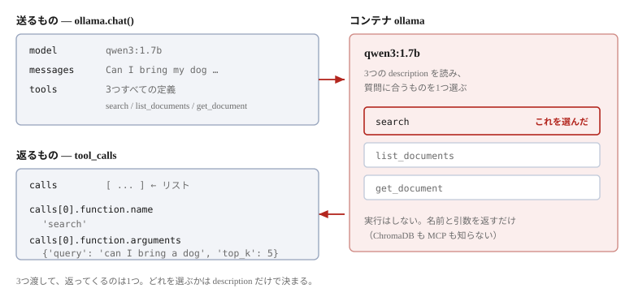

# RAG を完成させる


最後の部品を載せる。ここまでは検索して**取り出す**ところまでだった。
取り出した文書を LLM に渡し、**答えを書かせる**。

```bash
docker compose exec app uv run python steps/04_rag.py
```

[Ollama を用意する](08-ollama-setup.md) でモデルを取得していることが前提である。

## 動かす

```
Question: Can I bring my dog to the cafe?

[1] tools from the server: ['search', 'list_documents', 'get_document']

[2] asking the LLM what to do
    it asked for: search({'query': 'can I bring a dog', 'top_k': 5})

[3] calling the tool through the MCP server
    got 7401 characters back

[4] asking the LLM to answer from them

========================================================================
Answer
========================================================================
Yes, you can bring your dog to the cafe. The passage states that dogs are
welcome on the small terrace at the top of the stairs, but not inside the
room itself. There is a water bowl by the terrace door, and assistance
animals are welcome anywhere.
```

全体で1分から数分かかる。**待ち時間のほとんどは [2] と [4]**、つまり LLM である。
ある実行では、合計 227 秒のうち 210 秒がこの2つだった（[3] の検索は1秒かからない）。

CPU で推論しているので、**マシンと、そのときの混み具合で大きく変わる**。
同じコマンドが1分で終わることも、数分かかることもある。

**資料に書いてあるとおりの答えが返っている。** テラスは可、室内は不可、水飲み場あり、
介助動物はどこでも可。`faq.txt` の `ANIMALS` の節そのままである。

## 検索しないとどうなるか

同じ質問を、検索なしで LLM に直接投げる。

```
Yes, you can bring your dog to The Wandering Kettle, but there are a few
things to keep in mind:

1. **Pet Policies**: Check the cafe's policies regarding pets. Some cafes
   may allow pets, others may require a pet license or fee, ...

2. **Size and Space**: If the cafe has a small space or limited seating
   for pets, you m...
```

**一般論しか言えない。** この店は架空なので、LLM は知りようがない。
それでも「Yes」と答え、それらしい注意事項を並べる。

この対比が RAG の値打ちである。**知らないことを、知っているかのように答えさせない。**

## コードを読む

`steps/04_rag.py` である。前章までに出てきたものしか使っていない。

### ツール定義を詰め替える

```python
def to_ollama_format(tools):
    return [{
        "type": "function",
        "function": {
            "name": tool.name,
            "description": tool.description,
            "parameters": tool.input_schema,
        },
    } for tool in tools]
```

`session.list_tools()` が返したものを、Ollama の形に入れ替える。
中身の JSON Schema はそのままである。

### 1回目 — どうするか決めさせる

```python
decision = ollama.chat(
    model=MODEL,
    messages=[{"role": "user", "content": QUESTION}],
    tools=ollama_tools,
)

calls = decision.message.tool_calls
name = calls[0].function.name
arguments = calls[0].function.arguments
```

**質問とツール定義を一緒に渡す。** 返ってくるのは `tool_calls` で、
「`search` をこの引数で呼べ」という指示である。



`decision.message.tool_calls` は**リスト**である。中身を1つ取り出すとこうなる。

```python
>>> calls = decision.message.tool_calls
>>> calls
[ToolCall(function=Function(name='search', arguments={'query': 'can I bring a dog', 'top_k': 5}))]

>>> calls[0].function.name
'search'
>>> calls[0].function.arguments
{'query': 'can I bring a dog', 'top_k': 5}
```

`name` が呼ぶツールの名前、`arguments` がその引数である。
このまま `session.call_tool(name, arguments)` に渡せる形になっている。

> [!NOTE]
> **既定値は、補われたり補われなかったりする**
>
> `top_k: 5` は質問に書いていない。`inputSchema` の既定値を LLM が書き足したものである。
> ただし毎回ではない。同じ質問を6回投げると、`top_k` が入ったのは4回だった。
>
> ```python
> {'query': 'can I bring a dog', 'top_k': 5}
> {'query': 'can I bring a dog'}
> ```
>
> 省かれても困らない。**既定値はサーバー側の関数が持っている**ので、
> `top_k` が無ければ `def search(query: str, top_k: int = 5)` の 5 が使われる。

> [!NOTE]
> **`tool_calls` が空のこともある**
>
> LLM がツールを使わずに答えると判断した場合、`tool_calls` は `None` になる。
> 本文だけが返るので、そのまま表示する。
>
> ```python
> if not calls:
>     print(decision.message.content)
>     return
> ```

### 選ばれたツールを、MCP で呼ぶ

1回目で返ってきた `name` と `arguments` を、**そのまま**渡す。

```python
result = await session.call_tool(name, arguments)
passages = result.content[0].text
```

クライアントは中身を解釈していない。LLM が言った名前と引数を転送しただけである。
**ここで初めて ChromaDB が動く**（6章・7章で見た `tools/call` である）。

返る `CallToolResult` から本文を取り出す。

```
result.content      1件のリスト
result.content[0]   type は "text"
passages            7401 文字
```

この 7401 文字が、サーバーの `search()` が返した文字列そのものである。
`top_k` が 5 なので、**5件分が1本のテキストに連なっている**。

```
[1] source: faq.txt (distance: 0.21)
[2] source: allergens.txt (distance: 0.23)
[3] source: menu_drinks.txt (distance: 0.24)
[4] source: menu_food.txt (distance: 0.25)
[5] source: hours_access.txt (distance: 0.25)
```

### 検索結果を、質問文に埋め込む

ここが RAG の **A**（Augmented）にあたる部分である。

```python
prompt = (
    "Answer the question using only the reference material below.\n\n"
    f"[Reference]\n{passages}\n\n"
    f"[Question]\n{QUESTION}\n\n"
    "[Answer]"
)
```

組み上がるのは、こういう1本の文字列である（全体で 7529 文字）。

```
Answer the question using only the reference material below.

[Reference]
[1] source: faq.txt (distance: 0.21)
passage:
                              ← ここに検索結果 7401 文字（5件分）が入る
[Question]
Can I bring my dog to the cafe?

[Answer]
```

**`[Reference]` と `[Question]` は、ただの目印である。** 決まった書式ではない。
LLM に「ここからが資料、ここからが質問」と伝わればよい。

### 2回目 — 答えを書かせる

```python
answer = ollama.chat(model=MODEL, messages=[{"role": "user", "content": prompt}], think=False)
```

**`tools` を渡していない。** 求めているのは判断ではなく作文だからである。

`using only the reference material` と書いているのは、
**手持ちの知識で補わせない**ためである。上で見たような一般論を混ぜられると困る。

> [!NOTE]
> **`think=False` は2回目だけに付けている**
>
> 省くと `qwen3` は考えた過程も返し、20秒ほど余計にかかる。
> それなら常に切ればよさそうだが、**1回目で切るとツールを選び損ねる**。
> 質問4種を6回ずつ投げた結果である。
>
> ```
>                   tool_calls が返った
> think を省く           24/24
> think=False            20/24
> ```
>
> 選ぶものが無い2回目だけ切っている。

## 組み上がったもの

```
[1] tools/list        サーバーが持つツールを聞く        ← Step 2, 3
[2] LLM が判断         どのツールを呼ぶか決める
[3] tools/call        ChromaDB を引く                  ← Step 1, 2
[4] LLM が作文         取り出した文書から答えを書く
```

前章で見た RAG の3段階（9章）が、コードのどの行にあたるかを並べると、こうなる。

| | コード | 段階 |
|---|-------|------|
| [3] | `session.call_tool(name, arguments)` | **R**etrieval |
| | `f"[Reference]\n{passages}..."` | **A**ugmented |
| [4] | `ollama.chat(messages=[...prompt...])` | **G**eneration |

**A は関数呼び出しですらない。** 文字列を組み立てているだけである。
RAG の中心にあるのは、特別な仕組みではなく**この連結**である。

## ここまでで分かったこと

- 1回目で返った `name` と `arguments` は、**そのまま** `call_tool()` に渡せる
- 検索結果は `content[0].text` に入る。`search()` の戻り値そのままである
- **A（Augmented）の正体は文字列の連結**。`[Reference]` は書式ではなく、ただの目印
- 2回目はツール定義を渡さない。求めるのが判断ではなく作文だから
- `using only the reference material` で、手持ちの知識を混ぜさせない
- 検索なしでは、架空の店について**それらしい嘘**を答える

## この先

`src/` には、同じことを対話形式でやる完成版がある。
次章で、それを対話で動かす。
